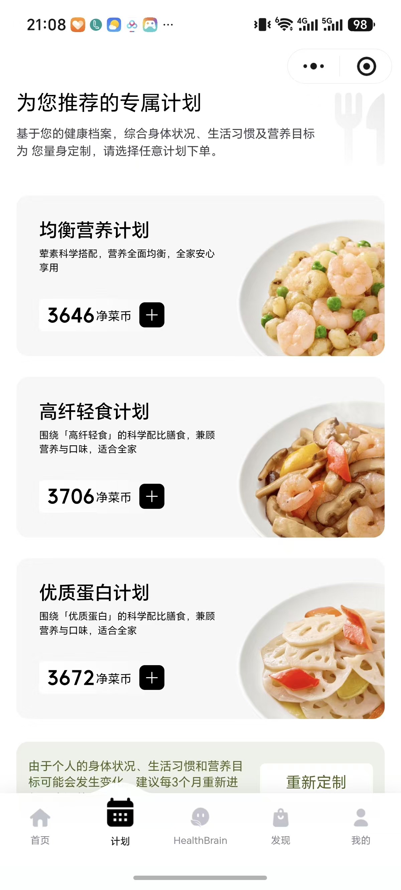

# 家庭 AI 营养师微信小程序前端开发文档

2026-10-21 主线确认：正式客户端只允许微信登录，云端本人资料完整并确认当前版本后进入 AI 对话首页；受邀人接受邀请后也遵守这一落点，不重新设置全家使用方式和默认就餐者。普通家庭邀请可多人建立各自档案，绑定成员邀请仅由一个账号认领已有档案。商城不提供独立登录或逛商城入口。采购支持本餐、今日安排下方“一键选购”汇总，以及 AI 判断明确购买意图后展示真实指定菜品食材包；对话购包无需先加入今日餐单。详见[实施说明](统一微信主线实施说明-20261021.md)。此前历史流程与本条冲突时以本条为准。

版本：v1.0
日期：2026-10-06
交付阶段：前端页面与交互开发，使用模拟数据，为后续后端联调预留接口。
产品依据：[家庭 AI 营养师微信小程序产品需求规格](家庭AI营养师-小程序产品需求规格-v1.0.md)，正文 v1.3，更新于 2026-10-13。

本阶段先完成可在微信开发者工具中编译、浏览和操作的前端。登录建档、家庭档案、AI 对话、今日三餐、购买、21 天计划、订单、烹饪、记餐和反馈均应有连续可操作的路径。后端尚未接入时，通过统一的模拟服务提供数据和状态，后续联调替换服务实现，保留页面与组件。

视觉采用用户提供小程序的白底、大留白、清晰文字和食物图片，结合苹果界面的分组列表、克制圆角、轻分隔和细腻反馈。产品功能及入口顺序按 PRD 实施。

## 开发目标与职责

### 本阶段交付

1. 完整页面与路由，统一视觉规范及公共组件。
2. 表单填写、成员切换、换菜、采购勾选、报价展示等真实前端交互。
3. 异步模拟服务及可复现的成功、空、失败、冲突、超时场景。
4. 模拟订单与记录能跨页面关联，并保留操作后的状态。
5. 微信开发者工具导入说明、页面截图和前端验收记录。
6. 前后端约定的候选数据结构、接口需求清单和联调待办。

本阶段完成标准是“微信小程序前端可运行并可完整演示”。真实服务联调、业务计算准确性和正式上线分别验收。

### 职责分工

| 领域 | 前端负责 | 后端及业务团队负责 |
| --- | --- | --- |
| 身份与家庭 | 登录入口、接受邀请、建档、权限结果展示、异常恢复 | 微信凭证校验、会话、账号映射、授权和原子认领 |
| AI 与健康 | 消息、流式效果、推荐卡、检查结果、来源及撤回展示 | 模型调用、长期信息提取、疾病规则、安全检查和内容依据 |
| 菜单与采购 | 成员选择、换菜操作、勾选保留、更新提示 | 菜谱及份量、食材合并、SKU 映射和安全候选 |
| 商城与履约 | 商品、地址、日期、报价、支付入口、订单及售后交互 | 价格库存、有效报价、订单、支付回调、21 批排程及退款计算 |
| 图片与记录 | 拍摄/选择、上传状态、结果确认、纠错及记录页面 | 文件存储、识别、营养估算、记录持久化及反馈生成 |
| 内容与运营 | 图片及配置展示、缺失兜底 | 合格菜谱、步骤图片、商品素材、社群二维码和合作申请接收 |

前端不直接连接模型管理接口，不保存模型密钥、微信 AppSecret 或 Supabase service-role 凭证。Supabase 与商城的鉴权接入方式由后端给出；前端通过适配层调用约定服务。

### 最新产品补充

用户于 2026-10-06 确认：家庭成员在对话中明确提供另一位成员的长期健康信息时，AI 可以更新该成员的档案，即使该档案已被本人认领。例如爸爸说“妈妈有糖尿病”，在成员归属明确时可自动写入妈妈档案，不再要求妈妈重复确认。

前端展示写入结果、目标成员、信息来源和撤回入口；疾病信息标为“用户自述”，来源进一步区分“本人提供”和“家人提供”。该能力不自动授予家人任意手动编辑已认领档案的权限，也不改变体检报告需本人同意才能共享的规则。目标成员不明时仍先追问，实际饮食记录更正仍先确认。

这一条是对 PRD 第 3.2、4.1 节的明确补充。原 PRD 本次不改写，后续统一修订时需同步；前端开发按此补充实现。

## 现有工程与复用方式

当前工程为 Uni-app、Vue 3 和 Vite，已包含多条页面路由及本地交互模拟。继续在现有工程开发，不另建一套 H5 代替小程序。

| 文件或目录 | 用途 | 本阶段处理方式 |
| --- | --- | --- |
| `src/pages.json` | 页面注册与全局样式 | 核对完整路由，新增独立详情及地址等必要页面 |
| `src/manifest.json` | 小程序 AppID 与平台配置 | 开发时配置实际 AppID，保留环境区分 |
| `src/pages/` | 已有业务页面 | 按 PRD 校正交互并统一视觉 |
| `src/components/` | 成员、菜单、营养等组件 | 优先复用业务能力，整理样式及输入输出 |
| `src/utils/` | 当前演示逻辑及本地存储 | 逐步收敛到模拟服务与状态模块，保持已有流程可用 |
| `src/uni.scss`、`src/styles/theme.css` | 当前奶油色、深绿色主题 | 改为白色、浅灰、深色文字及少量绿色强调 |
| `dist/` | 构建产物 | 从源码重新构建，不直接编辑 |

2026-10-06 工程检查：微信 AppID 为空；已有小程序构建配置使用 `touristappid`，构建产物中的页面清单落后于当前源码。后续必须重新编译后导入开发者工具，不能把现有 `dist` 当作最新实现。

当前 README 和“开始开发”文档有旧版本流程，例如购买前独立过敏复核、专业复核和 `reviewStatus`。业务要求以 PRD v1.2 和本次产品补充为准；不把这些旧描述带回新页面。

## 视觉设计

### 参考页面的采用方式

| 参考 | 采用的视觉特点 | 对应本产品 |
| --- | --- | --- |
| 专属计划页 | 白色页面、左文右图的大卡片、大标题、明确价格层级 | 经济型、标准型、品质型计划卡；首批价与 21 天总价分别展示 |
| AI 对话页 | 干净导航、简洁欢迎区、轻量问题按钮、固定输入区 | 今日三餐与当天对话为主体，欢迎区只在适当空态使用 |
| 我的页 | 头像与身份区、简洁图标、清晰区域划分 | 我的家卡片、使用方式及 PRD 规定的四组菜单 |

参考图中的 HealthBrain 名称、角色形象、净菜币、会员卡、钱包、收藏、购物车及五栏导航不作为本产品新增需求。参考图的采用范围不构成人群使用限制；所有家庭成员均可使用。按[全人群配餐修改方案](家庭AI营养师-全人群配餐修改方案.md)执行，不新增孕产阶段建档字段，依据已有资料与对话信息适配建议。

### 苹果风格的具体落地

以“清楚、轻盈、容易操作”为方向。使用系统中文字体和稳定回退字体，浅灰分组背景配白色卡片；层级依靠字号、字重、间距与分隔建立。食品图片提供视觉重心，绿色只用于少量强调和有效状态。默认浅色主题，深色模式后续另行安排。

本项目需要微信 iOS 与 Android 的一致可用性，不依赖苹果专属字体文件或 SF Symbols。图标采用统一、可用于小程序的本地 PNG/图标资源；不用 Emoji 作为正式导航图标。头像和品牌图形使用自有或已授权素材。

### 建议设计变量

以下为本阶段默认视觉参数，可在首轮核心页面评审后统一微调，不改变业务规则。以 375px 设计宽度为参考，750rpx 对应屏幕宽度；例如该宽度下 32rpx 约为 16px。

| 类型 | 默认值 | 应用 |
| --- | --- | --- |
| 页面背景 | `#FFFFFF` | AI 页、计划推荐等内容页 |
| 分组背景 | `#F5F5F7` | 我的、表单、记录及订单 |
| 卡片背景 | `#FFFFFF` 或 `#F7F7F8` | 按所在页面形成轻微层次 |
| 主文字 | `#1D1D1F` | 标题、关键内容 |
| 次文字 | `#63636B` | 说明、辅助内容；检查实际对比度 |
| 分隔线 | `#E5E5EA` | 列表与分组边界 |
| 强调色 | `#246B50` | 选择、关键动作或少量品牌点缀 |
| 状态色 | 成功 `#246B50`、警示 `#946200`、错误 `#C73632` | 配合文字/图标，不只靠颜色区分 |
| 页面左右留白 | `32rpx` | 小屏可按内容调整 |
| 间距档位 | `8 / 16 / 24 / 32 / 48rpx` | 组件内部、卡片间及章节间 |
| 页面大标题 | `48–56rpx`，字重 600 | 计划、我的等首屏标题 |
| 区块标题 | `34–40rpx`，字重 600 | 菜单、分组标题 |
| 正文 | `30–32rpx` | 主要说明与表单 |
| 辅助文字 | `26–28rpx` | 状态、估算依据及次要说明 |
| 卡片圆角 | `24–32rpx` | 计划、分组卡片 |
| 半屏面板圆角 | 顶部 `32rpx` | 就餐成员、限制编辑等 |
| 主要按钮 | 高度至少 `88rpx` | 深色/绿色实底，清晰白字 |
| 动效 | `160–240ms` | 面板、选择、按下反馈；减少动效时降级 |

关键可点击区域目标至少约 44px，不能只放大图标而缩小触区。价格使用人民币 `¥`，单位、规格、估算性质及测试标识保持可读。大段英文小标题、宋体大标题、满屏渐变和重阴影不作为默认样式。

### 图片规范

计划卡可采用左侧文字、右侧食物近景，右图不压住名称、适用成员和两类金额。小屏时文字优先，图片缩小或转为上下结构。商品列表使用统一比例缩略图；菜品做法使用横向主图和逐步图片。

参考截图保存在文档附件中，仅供设计对照。开发包使用自有/授权的食品及步骤素材，不把截图裁成业务商品图；截图不进入 `src/static`。图片加载失败显示统一兜底及必要重试，不能丢失文字和操作。

## 导航与页面清单

主入口遵循“AI 首页 → 各业务页”和“AI 首页右上角 → 我的”。详情页可返回，直接打开时有安全回到首页的路径。历史记录按天进入当天对话内容，不用饮食记录替代。

PRD 要求家庭总览保留底部小程序导航，当前源码中该导航已移除，需在实施时显式核对。本阶段建议为家庭总览配置“AI 首页／我的”两个既有入口，不据参考图新建五栏全局 TabBar；导航栏目为实现建议，可在核心页面评审时统一定稿。

以下现有路由以 `src/pages.json` 为准。“拟新增”表示业务页面需要独立表达，命名是前端建议，非已存在代码。

| 页面 | 当前或拟定路由 | 前端交付要求 | PRD |
| --- | --- | --- | --- |
| 登录入口 | `pages/index/index` | 模拟登录、失败/重试、首次与已建档分流 | 3.2 |
| 三页建档 | `pages/onboarding/index` | 三步进度、逐页保存、成员独立草稿与跳过 | 3.1 |
| AI 首页 | `pages/chat/index` | 今日三餐、对话、四入口及社群二维码 | 2、4 |
| 对话历史 | 拟新增 `pages/chat/history` | 日期列表、摘要、进入历史；历史只读展示 | 4.1 |
| 家庭总览 | `pages/profile/index` | 轻量成员列表、添加、家庭邀请与导航 | 3.1、3.2 |
| 成员详情 | `pages/profile/member` | 三个一级卡片、编辑、本人邀请 | 3.1 |
| 报告管理 | 拟新增 `pages/reports/index` | 当前成员文件列表、上传与解析状态 | 3.1 |
| 报告核对 | 拟新增 `pages/reports/detail` | 查看来源、核对识别内容、共享状态 | 3.1、3.2 |
| 家庭邀请 | `pages/invite/index` | 登录、邀请范围、接受/拒绝、受邀建档 | 3.2 |
| 本餐合并页 | `pages/shop/index` | 本餐安排、营养、菜品、食材及直接结算 | 5.4 |
| 单道菜做法 | `pages/recipe/index` | 独立详情、完整图文、返回保留清单 | 5.5 |
| 单包详情 | `pages/shop/detail` | 商品规格、全部配料及对应做法 | 5.7 |
| 今日采购清单 | 拟新增 `pages/shop/daily-list` | 跨餐汇总、排除某餐、保留不买选择 | 4.3 |
| 地址选择 | 拟新增 `pages/address/index` | 空态、多地址、选择及返回 | 6.4 |
| 地址新增编辑 | 拟新增 `pages/address/edit` | 同一表单、必填校验、保存并使用 | 6.4 |
| 结算 | 拟新增 `pages/checkout/index` | 普通与计划共用展示组件，费用及报价复核 | 5.7、6.3 |
| 专属计划推荐 | `pages/exclusive-plans/index` | 三档卡片、简短档案说明、双入口同页 | 6.1 |
| 专属计划详情 | `pages/exclusive-plans/detail` | 21 天三餐、全部净菜、安全状态及两类金额 | 6.1、6.2 |
| 确认配送 | `pages/exclusive-plans/schedule` | 地址、首批日期、全部 21 批安排 | 6.4 |
| 订单列表 | `pages/orders/index` | 全部/进行中/已完成，普通与计划类型 | 7.1 |
| 订单详情 | `pages/orders/detail` | 物流、批次、收货、正式变更与烹饪入口 | 6.5、7 |
| 售后申请详情 | 拟新增 `pages/orders/after-sale` | 批次/商品/数量、期望、原因、状态及补资料 | 7.2 |
| 整餐烹饪 | `pages/cook/index` | 菜品标签切换同源做法、去拍照记餐 | 5.6 |
| 拍照与统一记餐 | `pages/scan/index` | 相机/相册/食谱/手填、分析和逐人份量 | 8.1 |
| 饮食记录列表 | `pages/records/index` | 成员、日期、餐次及未记录状态 | 8.2 |
| 饮食记录详情 | 拟新增 `pages/records/detail` | 原图、来源、份量、估算依据与更正 | 8.2 |
| 反馈 | `pages/feedback/index` | 全家/成员、当餐/当日/近期趋势 | 8.3 |
| 长期记忆 | `pages/memories/index` | 来源、成员、修改/删除/撤回 | 4.1、本次补充 |
| 我的 | `pages/my/index` | 我的家、方式切换及规定四组菜单 | 2 |
| 隐私与账号 | 拟新增 `pages/settings/privacy` | 共享范围、账号状态及退出等交互入口 | 3.2、11 |
| 合作商合作 | `pages/supplier/index` | 三类合作、适用字段、提交与重试 | 9 |
| 健康设备 | `pages/devices/index` | 标题、图标、“敬请期待” | 2 |

现有 `pages/plan/index` 属旧菜单兼容路径，优先将新入口统一到本餐合并页，避免展示两套采购流程。换菜、成员选择、暂停/恢复、退款预览等可采用面板，不为每个动作强行新增页面。

## 核心页面与交互

### 三页建档与家庭资料

建档共三步：使用方式、成员基础资料与默认就餐选择合为首步，后续为饮食目标与基础健康、健康限制与报告。“只为自己”按本人一位安排；“自己和家人”按勾选的成员计算默认人数，至少一位且不限制为四位。首次只建立“我”，家人主动添加且不自动勾选为就餐者。切换成员保留表单，切换使用方式保留家人档案和家庭就餐选择；旧四步草稿保留资料并映射到新三步。身高体重和健康资料可按 PRD 稍后补填，建档不收集配送地址和电话。

健康、过敏、不耐受、忌口、医生要求均区分未填写、明确没有、已填写。基础病支持 PRD 六类选项及“其他”输入；疾病摘要只读，医生要求优先，目标标签不推断成疾病。口味和菜系按 PRD 列表呈现，普通字段异常允许复核或继续保存。

家庭总览只放轻量成员卡。成员详情恰好基础资料、基础病情况、每日饮食三个一级卡片；限制和医嘱用半屏面板编辑，报告进入统一管理页。每日饮食展示实际记录，没有记录写“未记录”。维护档案不重新走首次建档。

受邀建档复用成员表单，跳过方式和共同人数。普通邀请创建本人档案，绑定邀请核对现有资料；已认领、无效凭证、无权限和拒绝均有对应状态。分享凭证通过模拟/真实服务获取，页面只提供微信 `onShareAppMessage` 所需信息，不自行生成生产签名。

### AI 首页

顶部左侧历史记录，右侧我的。主体上方自动展示今日早餐、午餐、晚餐，随页面滚动离开屏幕，不吸顶。每餐人数胶囊在当前页打开半屏选择；“查看本餐安排 >”为明确入口，整卡不任意跳转。

输入框上方入口顺序固定为 AI专属计划、家庭健康档案、拍照看热量、今日饮食计划，另设加入社群。第四入口只临时展开同一份计划，不创建消息、不写历史、不触发重复生成。加入社群直接弹配置二维码；配置缺失或失效时展示说明和重试状态。

日常 AI 先输出分析，再展示菜单/商品入口。模拟回复采用结构化分段结果，支持生成中、失败、重试及部分输出后失败，不能把商品卡当分析正文。历史以北京时间日期组织；测试场景可切换日期验证跨日。

三餐来源依次为已生效且正常执行的已购买计划、前一天保存的明日提议、当前档案建议。暂停/未生效/结束计划不进入第一优先级。正常执行的计划隐藏今日一键采购；查看该餐进入计划对应路径。

### 本餐与采购

合并页顺序为本餐基本信息、全部菜品、食材购买清单、合计和直接购买。顶部包含餐次、成员、总体营养估算、检查结果、烹饪注意及有差异成员的吃法；不显示预计用时或菜品数量。总体估算与个人差异分开，不重复列出无差异成员。

就餐成员变化时调用模拟/真实更新服务，展示健康检查、菜单、份量、食材、包装及报价的更新结果。人数不变但换成员仍触发检查。不能按人数直接乘价格。保留仍存在食材的勾选状态，新增食材默认选中，不需要的移除；只展示最新一次请求结果。

有合格候选才展示换一换，最多 3 道，1–2 道展示实际数量，零候选隐藏。只换当前菜，不追问原因，不自动记成长期口味。更换后同步营养、食材、必要报价和做法。

今日采购先合并三餐食材需求再映射包装，保留不购买选择并允许排除某餐。返回单菜详情时保留勾选、金额、成员及尽可能保留滚动位置。所有结算均先核对商品、数量、地址、配送和价格；不加独立过敏确认页。

### 计划与订单

专属计划推荐页采用参考图的大卡片布局，名称为经济型、标准型、品质型；显示实际差异、适用成员、首批三餐食材预估价及 21 天预计总价。标题下只有简短档案说明，不新增长篇分析或选档推荐。

详情可预览前两天并展开全部 21 天三餐、菜谱版本及全部净菜。下一步按地址、首批预计送达日、21 批安排推进。结算区分预估报价、有效报价及支付后快照；商品价、服务费、配送费、优惠和总价分项展示。

模拟支付通过独立测试结果入口返回成功、取消、失败、结果待确认。支付入口回调后还需查询模拟/真实订单结果；结果不明时保持待确认，不直接展示已支付，也不允许盲目重新支付。所有支付相关模拟界面标“测试数据，不会扣款”。

订单列表使用全部、进行中、已完成三栏。计划显示已收 X/21 批，一批收货不完成整单。未结售后/退款仍在进行中；取消最终状态写已取消。暂停/恢复、改单批地址、取消剩余计划和退款预览分别显示可操作范围和返回结果。

售后先选批次，再选商品和数量，期望结果是希望补发、希望退款、请工作人员联系我。重复申请引导查看已有工单；提交失败保留输入。已发货/收货商品售后与未发货剩余取消分开，测试第 7 批操作不影响其他批次。

已支付快照与日常建议分开保存。新健康冲突影响已付款批次时，前端展示服务返回的风险及允许操作，不擅自改历史商品或退款金额；实际拦截配送、替换及退款规则属于联调待决事项。

### 烹饪与记餐

购买前每道菜可进入独立完整图文做法页，含图片、用时、食材用量、逐步文字图片和注意事项。视频非必需，没有合格视频就不出现视频播放器或占位。

收货后从订单/批次按餐进入“午餐制作”等整餐页。顶部菜品标签切换所有内容，读取购买时菜谱版本；没有单菜完成按钮或进度。底部去拍照记录这一餐，携带餐次、适用成员与来源订单信息。

拍照页使用小程序相机组件与相册能力；开发者工具设备能力不可用时提供明确测试图片入口。真实采集图片和模拟识别分开标识，模拟结果说明并非实际识别。拒绝相机权限仍可相册、当天食谱选菜或手填。

分析面板展示任务状态、照片、菜品和宽范围估算。风险不确定写“暂无法确认”。共享桌菜逐人确认吃过的菜与少量/一般/较多/不确定，不自动平均热量。原图加文字/语音纠错与更换图片为不同操作，失败保留已填写份量。

仅保存和保存并聊聊共用同一记录 ID，连点只保存一次，跳转失败不重复创建。更正保留 ID、增加版本并刷新反馈；AI 意图更正实际记录时先展示拟更正内容让用户确认。

### 反馈与记忆

反馈可切全家/成员和当餐/当日/近 7 天/近 30 天。个人只读取本人确认摄入，缺失餐次写未记录，不推断没有进食；无记录日不按零蔬菜计入趋势，样本不足只描述已有记录。主图用已记录餐次的蔬菜搭配，不用固定热量伪装健康趋势。

删除、更正或撤回记录后，模拟服务也需刷新受影响反馈及下一餐依据。长期记忆可查看目标成员、内容、来源、日期并修改/删除/撤回。一次性体验留在当餐，明确长期信息才写入档案；家人提供的跨成员信息按本次补充执行。

“我的”严格采用 PRD 四组菜单，合作入口紧接隐私与账号。健康设备只有图标和敬请期待。合作申请先选三类合作，再填写适用字段，成功需在模拟/真实服务返回受理后展示；失败保留表单。

## 公共组件

以下名称是组件拆分建议，可复用现有组件后逐步整理。

| 组件 | 责任与注意点 |
| --- | --- |
| `AppNavBar` | 状态栏、胶囊避让、返回和标题；不绘制假的微信胶囊 |
| `PageState` | 加载、空、错误、重试、无权限统一布局 |
| `BottomSheet` | 半屏编辑、遮罩、内部滚动、关闭和键盘处理 |
| `MemberPicker` | 具体成员多选、当前餐次、保存及取消 |
| `ProfileFieldRow` | 行标题、三态摘要、进入半屏编辑 |
| `TodayMealCard` | 餐次、来源、人数胶囊和明确菜单入口 |
| `ChatMessage`、`ChatComposer` | 消息类型、记录关联、文本/录音/发送状态 |
| `SafetyStatus`、`NutritionSummary` | 已知冲突、一般建议、未知状态及估算依据 |
| `DishCard`、`RecipeContent` | 菜品、候选入口与同源做法展示 |
| `IngredientRow`、`PriceSummary` | 规格、数量、选择与费用分项 |
| `PlanCard`、`BatchCard` | 首批与总价、21 批状态及允许动作 |
| `AddressCard`、`GroupedMenu` | 地址展示及我的分组列表 |
| `RecordCard`、`TrendChart` | 原始记录、缺失样本与可追溯趋势 |
| `MockModeBadge` | 持续识别测试环境，数值旁简短标识，不堆叠长免责声明 |

表单、金额、状态不能各页面复制一套计算。公共组件接收数据和触发事件，服务模块决定业务结果。

## 模拟服务与状态管理

### 建议目录

```text
src/
  pages/                 页面与路由
  components/            复用视图
  services/
    index.js             服务选择入口
    contracts/           数据字段说明与样例
    mock/                异步模拟服务
    api/                 真实请求与字段适配
    request.js           会话、超时与错误处理
  stores/                Vue 状态模块
  fixtures/              可复现测试场景及 21 天数据
  styles/                颜色、字号、间距等变量
  utils/                 格式化及已有逻辑的逐步迁移
  static/                小程序本地素材
```

继续使用现有 JavaScript 工程，不以全文迁移 TypeScript 或升级框架作为前置工作。先采用 Vue 响应式模块与现有存储；确需复杂全局状态时再评估 Pinia，避免为演示重复引入状态体系。

页面统一调用服务入口；模拟和真实服务使用相同异步方法及数据形状。模拟数据也返回 Promise，覆盖加载、延时和失败。通过开发配置选择 `mock` 或 `api`，测试控制只存在开发环境，不进入正式菜单。

### 状态划分

| 状态 | 保存及隔离方式 |
| --- | --- |
| 账号与家庭 | 按模拟账号/家庭分别存储，切换账号不读取上一账号资料 |
| 成员资料与记忆 | 成员 ID、资料版本、来源事件及可撤回变更 |
| 今日计划 | 按北京时间日期、家庭和来源保存；两处展示引用同一对象 |
| 餐次与清单草稿 | 餐次 ID、成员、勾选、最新更新请求及滚动位置 |
| 报价 | 报价 ID、到期时间、菜单/资料版本及费用明细 |
| 订单与批次 | 下单时独立快照，和可变建议隔离 |
| 对话与饮食记录 | 对话按日，记录 ID 独立，消息可关联 recordId |
| 分析任务 | 文件/任务 ID、状态、纠错轮次、已确认内容 |

本地缓存仅保存开发测试数据、草稿和必要 UI 状态。模拟账号隔离用于验证流程，不能当作生产权限保障。重启恢复建档进度和已保存记录；临时相机文件失效时提示重新选择。退出或切换账号清理当前会话展示，重置测试数据只影响模拟命名空间。

### 防止异步覆盖

连续换成员或换菜时为请求设置序号，只应用当前餐次最新请求结果。更新期间保留上次内容并标记处理中，相关结算动作禁用。失败后提示重试，不把旧报价包装为最新价格。取消面板不提交草稿，保存成功才刷新对应成员/餐次。

## 联调数据契约建议

以下是前端需要的数据，不是已确认后端 URL。由后端、AI 和商城团队共同确定字段、错误码、状态枚举及版本；真实服务适配层可映射服务端命名。

### 核心对象

| 对象 | 至少需要的数据 |
| --- | --- |
| 会话 | accountId、householdId、本人 memberId、角色、有效期、可操作权限 |
| 成员 | memberId、profileVersion、已认领账号、基本资料、三态健康字段、来源 |
| 邀请 | 类型、目标家庭/成员、邀请人、共享范围、可接受结果、分享路径 |
| 今日计划 | date、source、sourceId、version、三餐 ID 与具体成员 |
| 餐次 | mealId、version、memberIds、菜品/配方版本、目标份量、营养区间、安全结果、食材清单 |
| 采购行 | ingredientId、requiredAmount、unit、skuId、packSize、quantity、selected、库存状态 |
| 报价 | quoteId、expiresAt、各版本引用、地址/日期、分项费用、优惠、总金额 |
| 21 天计划 | planId、version、档次、适用成员、21 天三餐、21 批及完整商品明细 |
| 订单 | orderId、type、支付状态、履约状态、支付及菜谱快照、batches、allowedActions |
| 图片任务 | analysisId、fileId、状态、候选、估算区间、依据、缺失信息及错误 |
| 饮食记录 | recordId、version、date、meal、来源、照片、每人菜品与份量、已确认状态 |
| 反馈 | recordIds/versions、成员/家庭范围、已记录/缺失餐次、统计口径、样本数 |
| 记忆变更 | changeId、目标 memberId、字段、前后值、提供者、消息来源、撤回结果 |
| 售后 | afterSaleId、订单/批次/商品/数量、期望、原因、附件、状态及实际处理结果 |

金额建议使用整数分和 `currency: CNY`，展示时统一格式化，不用浮点金额累加。商品总价以服务返回为准。所有营养估算注明单位、范围和依据；未知使用 null 或明确状态，不用 0 代替未知。

2026-10-13 菜品营养补充：每道菜的做法对象携带结构化 `nutrition`，独立详情在主图／名称后、制作时间前放置共用 `DishNutritionCard`；整餐烹饪页随菜品切换。两行三列展示能量、蛋白质、脂肪、碳水化合物、膳食纤维和钠，按每 100 克熟制后可食部分显示；未知用 `null`，已购读取营养快照。字段、单位、来源和后端版本级持久化要求见[菜品营养字段与后端存储契约](菜品营养字段与后端存储契约.md)。

### 服务清单

| 服务域 | 前端需要的方法或行为 |
| --- | --- |
| 身份家庭 | 建立/刷新会话、家庭读取、建档保存、成员编辑、创建/接受邀请 |
| 健康报告 | 文件上传、任务查询、报告核对、共享范围读取及更新 |
| 对话记忆 | 发送消息、流式事件、历史列表、按日详情、长期变更及撤回 |
| 菜单 | 获取今日计划、更新就餐者、获取替换候选、替换当前菜、获取做法 |
| 采购报价 | 获取本餐/全日清单、保存选择、结算预览、报价复核 |
| 计划配送 | 三档推荐、完整详情、地址管理、可预约日期、确认配送 |
| 订单支付 | 创建订单、支付参数、查询结果、订单列表详情、批次变更及收货 |
| 退款售后 | 退款预览、取消剩余、申请/查询售后、补资料 |
| 记录反馈 | 创建/更正/删除记录、列表详情、照片纠错、反馈查询 |
| 运营合作 | 社群配置、合作要求、提交申请及受理结果 |

建议约定统一错误结构，包含业务错误码、可展示说明、可否重试和 traceId。页面重点区分会话过期、无权限、资料不足、安全冲突、报价过期、缺货、不可配送、任务失败、网络超时和未知支付结果。正式权限和是否可购买均由服务端校验；前端按返回结果展示。

流式协议由 AI 后端定稿，小程序侧预留完整响应和增量响应适配，不直接套用浏览器 EventSource。生成推荐、价格和营养使用结构化业务对象，不从自然语言中解析数值或商品。

## 模拟场景与异常覆盖

模拟数据集中定义，可在开发测试入口切换。所有数据为虚构测试资料；21 天可复用样例菜谱，但展开后必须能看到完整 21 天、每天三餐和独立批次 ID，方便验证隔离与快照。

| 场景 | 应能验证的结果 |
| --- | --- |
| 新个人用户 | 无共同人数问题，先建立我，跳过健康资料后通用三餐 |
| 新家庭用户 | 家庭人数不创建同数量档案，后续添加/邀请 |
| 家庭三人且健康约束不同 | 三餐不同成员，同人数换成员仍复核 |
| 信息不足 | 明确通用建议，未知不显示为没有 |
| 已知冲突可解决/不可解决 | 自动更新建议；仍冲突时阻止结算且说明对象 |
| 0/1/2/3 个换菜候选 | 入口隐藏或展示实际候选，不凑数 |
| 包装数量不变/增加 | 份量变化但价格可不变，或数量与报价同步更新 |
| 已取消油盐采购 | 换菜/成员重算后不自动重新勾选仍存在食材 |
| 普通及绑定邀请 | 多人加入与单人认领、重复接受及无权限状态 |
| 家人更新已认领成员资料 | 来源及目标正确，提示后可撤回，未支付建议失效 |
| 未生效/执行/暂停/结束计划 | 今日来源优先级及一键采购显示正确 |
| 地址为空/报价过期/无可配送日期 | 可修复入口明确，无法进入支付 |
| 支付成功/取消/失败/待确认 | 查询订单后显示结果，防重复提交 |
| 第 7 批改址、售后或收货 | 其他批次及已支付历史不被误改 |
| 相机/录音拒绝授权 | 替代路径可用、无循环弹窗 |
| 识别失败/原图纠错 | 已选照片和逐人份量保留，可重试 |
| 保存并聊聊且跳转失败 | 一条记录，重试跳转不重复保存 |
| 缺餐/无记录日/样本不足 | 反馈不编造全日摄入或变化趋势 |
| 更正/删除/撤回 | 相关视图及后续依据同步刷新 |
| 合作申请失败/社群配置缺失 | 保留输入、显示失败而不是成功 |

普通表单校验、未知与无的区分、操作状态保留可在前端实现。模拟中的安全检查和营养示例仅用于验证交互；正式专业规则及指标不得从模拟逻辑直接发布。

## 微信小程序适配

1. 自定义导航根据状态栏与 `uni.getMenuButtonBoundingClientRect` 等可用平台能力计算布局并设置兜底，避开右上角微信胶囊；不使用参考截图的状态栏高度作为固定值。
2. 普通排版使用 rpx，胶囊和设备测量值按 px 处理。底部输入、购买栏、面板兼容安全区；页面内留足底部空间，长列表最后一项可完整露出。
3. 聊天输入适配键盘高度变化，防止微信自动上推和自行位移重复叠加；发消息后按用户阅读状态滚动，不强行把查看历史的用户拉到最新消息。
4. 使用 `view`、`text`、`image`、`scroll-view`、`camera` 等小程序组件与 Uni-app 能力，不依赖 DOM、window、浏览器存储或仅 H5 支持的播放器/图表。
5. 报告优先支持小程序可用的拍照、微信聊天文件选择，设备文件入口按实际能力显示；不可用时给替代方式。上传前控制文件类型与大小，取消保留草稿。
6. 图片压缩、懒加载，21 天与长历史按需展开或分页，避免初始渲染全部大图。模糊背景不是可用性前提，能力不足时用实色背景。
7. 详情通过 ID 获取状态，避免 URL 携带完整健康资料或长 JSON。长业务流程用合理返回/重定向控制页面栈，直接进入详情也能恢复对象或显示不存在。
8. 开发测试域名豁免只用于对应测试环境；真实接口联调配置合法请求、上传、下载等域名，不能将关闭域名校验当作上线方案。

## 开发顺序与完成条件

| 阶段 | 工作内容 | 完成条件 |
| --- | --- | --- |
| 工程与设计基础 | 环境核对、路由、设计变量、导航、页面状态、模拟服务 | 开发者工具启动；基础页面避让胶囊及安全区 |
| 核心视觉样板 | AI 首页、计划推荐、我的三页 | 参考视觉与 PRD 结构同时成立，确定公共样式 |
| 家庭与账号 | 登录、三步建档、总览/详情、报告、邀请 | 新用户和受邀流程连续，成员不串资料 |
| 菜单与普通购买 | 今日来源、成员重算、换菜、做法、汇总采购、地址与结算 | 一餐及全日采购流程可演示，返回保留状态 |
| 专属计划与订单 | 三档、完整 21 天、配送、模拟支付、批次/退款/售后 | 一次支付与 21 批行为可追踪，单批隔离成立 |
| 烹饪记录反馈 | 同源做法、拍照/手填/食谱、纠错、记录、反馈与记忆 | 保存、更正和撤回后的关联页面一致 |
| 完整前端验收 | 异常场景、窄屏、字体、开发者工具截图与交付说明 | 所有页面/入口可达，无核心死路，未接服务有明确标识 |
| 后续真实联调 | 按服务域切换真实适配器 | 真实回执、权限、状态及真机能力另行验收 |

阶段顺序用于组织实现，所有 PRD 页面仍在本阶段前端范围内，不把后三个模块永久删减。不在后端接口与素材条件未知时承诺固定生产上线工期。

## 微信开发者工具运行说明

项目根目录为 `D:\OneDrive\文档\ChatGPT\ai healthy agent`。2026-10-06 本机命令显示 Node.js v24.12.0、pnpm 10.33.0；依赖版本沿用现有锁文件，README 中 pnpm 11 的描述不作为自动升级要求。

首次准备环境时在项目根目录执行：

```powershell
pnpm install --frozen-lockfile
pnpm dev:mp-weixin
```

开发模式导入 `dist/dev/mp-weixin`，等待首次编译结束再打开。命令保持运行时修改源码会重新编译；若开发者工具未更新，检查所导入目录是否仍指向这份工程。

阶段交付构建执行：

```powershell
pnpm build:mp-weixin
```

构建模式导入 `dist/build/mp-weixin`。开发目录与构建目录选择一种，不混用。目录应有 `app.json` 和 `project.config.json`，页面路由与源码一致。

开发者工具导入步骤：

1. 使用微信开发者工具稳定版，新建/导入小程序项目，选择对应编译目录；不要直接把 Uni-app 源码根目录当微信原生项目导入。
2. 有团队实际 AppID 时填入 `src/manifest.json` 的 `mp-weixin.appid`，重新编译后用同一 AppID 导入。
3. 尚无 AppID 时，可在开发者工具支持的游客/测试模式查看普通页面；游客模式不作为微信登录、手机号、分享、支付或真机预览能力的验收方式。
4. 从登录入口走完整路径，再验证直接进入关键页面、返回、热更新和控制台错误。
5. 配置实际 AppID 后在 iOS、Android 真机检查胶囊、安全区、键盘、相机和录音等设备能力。

H5 仍可用于快速排版辅助检查，但微信开发者工具的编译及交互是本阶段主验收环境。

## 前端验收清单

下列为后续开发验收要求，不代表本次文档创建已经完成小程序实现。

- [ ] 最新源码能编译到微信小程序，导入目录及 AppID 配置有记录。
- [ ] AI 首页、计划推荐、我的使用统一白灰视觉和正确功能结构。
- [ ] 所有页面清单入口可达，返回和直接打开不存在核心死路。
- [ ] 三页建档、个人/家庭、受邀建档、未知/无/已填写状态符合 PRD。
- [ ] 家庭档案恰好三个一级卡片，报告入口和权限状态正确。
- [ ] 今日三餐不吸顶，成员半屏选择，来源一致，临时展开不创建消息。
- [ ] 换菜数量、同人数换成员、食材勾选保留和条件报价更新可验证。
- [ ] 本餐合并页直接结算，购买前完整图文可读，返回不丢草稿。
- [ ] 无独立过敏确认页、人工健康审核状态或“我已知晓”绕过。
- [ ] 计划首批与总价分开，21 天每天三餐及 21 批全部可展开。
- [ ] 地址变化、报价失效、不可配送和未知支付结果均有可操作状态。
- [ ] 批次收货/改址/售后不会误改其他批次，取消剩余与已收售后分开。
- [ ] 整餐烹饪同源，无单菜完成状态，拍照入口携带正确餐次及成员。
- [ ] 三种记餐入口只保存同一类型记录，两个去向无重复创建。
- [ ] 家庭桌菜按成员确认，营养未知不写 0，反馈显示缺餐及样本依据。
- [ ] 长期跨成员写入保留来源并可撤回，记录更正仍先确认。
- [ ] 健康设备仅敬请期待，合作申请失败不显示成功，社群配置可失效。
- [ ] 全局及逐项测试标识清晰，模拟操作不访问真实支付服务。
- [ ] 320px、375px、430px 参考宽度下无文字溢出或按钮遮挡，较大字体可读。
- [ ] 保存、支付、提交等按钮防连点，失败保留用户输入并可重试。
- [ ] 现有 `pnpm test` 回归通过，新增测试围绕状态一致性及关键规则。
- [ ] 开发者工具验收截图与缺陷记录齐全；真机与真实服务验收单独列示。

前端交付包括源码、模拟场景、最新小程序编译产物、运行说明及验收记录。纯样式调整无需大量镜像测试；优先验证同 ID 保存、报价失效、来源优先级和批次隔离等容易回归的行为。

## 联调前需要团队提供的内容

| 内容 | 牵头方 | 前端目前如何继续 |
| --- | --- | --- |
| 实际 AppID、开发成员权限与测试环境 | 项目/小程序负责人 | 普通页面用模拟模式，设备及微信能力待配置后验证 |
| 会话、家庭成员、邀请及共享契约 | 后端 | 模拟账号和权限结果，实现接受/拒绝及异常布局 |
| 家人提供健康信息的来源与撤回结果 | AI、后端 | 按本次补充准备写入/撤回场景，不扩展手动编辑权限 |
| 菜谱、配料、安全结果和营养依据 | AI、营养、商品 | 标明示例，覆盖可用/未知/冲突状态 |
| 三档差异、净菜、包装、价格与库存 | 商城、供应链 | 使用测试数据验证首批/总价及完整明细 |
| 配送日期、暂停/取消、退款和缺货规则 | 商城、供应链 | 展示模拟返回的可操作范围，不硬编码生产公式 |
| 已支付后新增健康冲突的处理 | 产品、AI、商城、供应链 | 显示风险与服务允许动作，保留支付快照 |
| 文件上传、报告核对与餐食识别任务 | 后端、AI | 采集与模拟分析分开，覆盖失败、权限拒绝和纠错 |
| 品牌图标、食物及步骤图片 | 设计、内容 | 用授权测试素材和统一兜底，步骤内容完整 |
| 社群配置及合作申请接口 | 运营、业务后端 | 模拟配置读取、真实式异步受理和失败 |

真实联调按会话与家庭、AI 菜单、图片与记录、商城报价订单、21 批履约依次推进。生产规则的定稿不阻止前端页面开发，但接口字段和状态变更需同步更新适配器及测试场景。

## 参考图片

### 专属计划参考



### AI 对话参考


### 我的参考


## 修订记录

| 日期 | 版本 | 内容 |
| --- | --- | --- |
| 2026-10-06 | v1.0 | 依据 PRD v1.2 制定前端阶段范围、参考视觉与苹果式细节、页面清单、交互、模拟服务、联调契约、微信工具运行及验收要求；补充已认领成员的跨成员 AI 档案写入规则。 |
