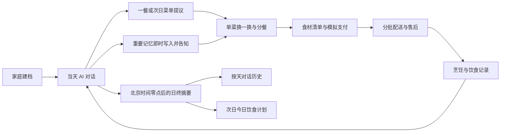
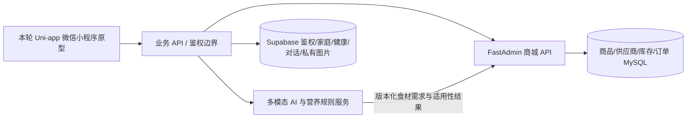

# 家庭营养师：现状盘点与详细实现方案（讨论稿）

> 2026-10-13 更新：本文为历史讨论与技术参考。人群范围按[全人群配餐修改方案](家庭AI营养师-全人群配餐修改方案.md)执行，原成年人限制及人工健康审核建议已被后续产品规格覆盖。
> 本文是早期讨论与源码盘点资料。当前确定的微信小程序目标产品规格以《家庭AI营养师-小程序产品需求规格-v1.0.md》为准；本文关于“A 版原型交付”、固定报价或模拟状态的描述，不代表正式产品范围。

更新：2026-09-28。本文以当前仓库源码、`README.md`、`docs/开始开发.md`、`offline-delivery/README.md` 为依据；第 10 节补充用户新提供的商城方案及五个开源项目的核对结果。本次增补用户确认的食材包推荐、21 天生效日期、订单售后和拍照记餐交互，均为**待实现方案**，不表示源码已经具备。用户已确认**本轮目标为 A：供团队评审的可点击原型**。第 4–7 节保留正式版设计蓝图，用于识别依赖与后续工作，不属于本轮原型交付承诺。**“原型已做”不等于“正式产品已定”**；标为“待定”的内容需要业务、营养专业人员、AI 与商城负责人共同确认。

> **产品口号：让每个家庭，拥有自己的 AI 营养师。**
>
> **产品设想：**围绕家人的健康状况，提供个性化膳食建议、全家可执行的每日食谱与拍照饮食分析，并连接蔬菜包、肉类包等食材购买服务，构建从健康管理到家庭餐桌的日常服务闭环。

上述是产品目标。本轮评审原型用虚拟家庭、固定对话脚本、样例食谱、照片预览与固定样例估算、模拟交易呈现完整体验；拍照饮食分析和真实购买服务仍需后续接入与验证。

## 1. 决策状态与目标

### 1.1 已明确的方向

| 事项 | 当前依据与结论 |
| --- | --- |
| 客户端与数据平台 | **用户最新明确：先做微信小程序，目前只做小程序；团队已确定采用 Supabase。** 当前 Uni-app + Vue 3 微信小程序/H5 原型继续作为本轮评审基础。Supabase 承担鉴权及家庭健康等业务数据，具体微信登录接法待接口设计；Flutter App 可作为后续方向，不能把当前代码写成 Flutter。 |
| 产品定位与口号 | “让每个家庭，拥有自己的 AI 营养师。”围绕家庭健康状态连接个性化建议、可执行三餐、拍照饮食分析及蔬菜包/肉类包等食材购买。此为产品目标；原型中的 AI、拍照分析和购买均以演示数据呈现。 |
| 体验主线 | 可跳过建档进入首页 → 按需补成员健康资料 → AI 对话/三餐建议 → 家庭共享菜单及个人分餐 → 采购 → 收货与烹饪 → 拍照/选食谱/手动记餐 → 反馈与下一餐。当前源码仅实现其中一部分演示。 |
| 导航 | 对话首页左上角为历史记录，右上角为“我”；订单入口放在“我的”，首页不重复放订单。 |
| 家庭菜单理念 | 优先一桌共享菜，按成员展示分餐差异；结合年龄与具体健康信息适配，过敏及已知医嘱冲突须自动检查并处理。 |
| 团队接口 | 新提供的商城 V1.3 文档记载：刘北萍负责 FastAdmin/ThinkPHP/MySQL 商城、订单和多供应商供应链；林恬伊负责前端交互与接口；刘潇、宋红阳负责 AI。该文档所写的 Uni-app 小程序方向与当前优先交付一致，但还需补 Supabase 身份和数据边界；文档对后端进度的陈述尚未通过源码核验。 |
| 原型交付 | 有可在本机运行的 H5/微信小程序源码，以及单 HTML 离线体验版。离线版只用虚拟数据，不接网络。 |
| 本轮目标 | 用户于 2026-09-27 确认：先做团队评审原型。原型需要明确展示范围、样例、用户操作与评审问题；真实服务对接另立实施阶段。 |
| 正式首期的交易目标 | 用户确认：未来要在**本小程序内**完成真实下单、支付、配送和售后；当前原型先用虚拟数据走完整个操作链，团队后续接接口。 |
| 正式服务人群 | 2026-10-13 修订为全体家庭成员，包括儿童及孕产成员；不增加阶段建档字段，由 AI 根据已有资料和对话信息适配并检查。以全人群配餐修改方案为准。 |
| 评审对象 | 本轮主要给内部团队成员及合作外包人员评审，要求细节较完整、流程能逐项过一遍；具体日期待定。 |
| 21 天计划原型 | 保留选计划、核对、选日期、21 次配送、下单及批次追踪的完整操作，但菜谱明确标为样例；暂不要求制作 21 天互不重复的内容。 |
| 慢病审核演示 | 先用虚拟“待审核 → 通过/退回补资料”状态展示；实际审核组织、资质与时限尚未确定。 |
| 计划餐次 | 21 天计划每天展示早餐、午餐、晚餐；可使用明确标注的样例菜谱。当前代码只有早餐和晚餐，午餐需要补入。 |
| 慢病案例 | 原型至少分别演示糖尿病和高血压成年成员；两者进入专业审核流程，未审核前不显示可购买的个体化菜单。 |
| AI 原型 | 固定问题脚本和预置回复；没有覆盖的自由问题明确提示本轮能力边界与可用的下一步，不假装已经调用真实模型。 |
| 历史与日终处理 | 左上角“历史记录”按天查看 AI 对话，每天一个对话，北京时间 00:00 切分。未来后端日终总结当天内容；谈到明天吃什么时，次日首页展示 AI 提议的计划，用户可再修改。原型先模拟。 |
| AI 长期记忆 | AI 检出明确的重要信息后可直接记入家庭档案或记忆，同时在对话中说明记住了什么；用户以后可修改。疾病等标为“用户自述”并进入安全审核，不能当作已核实诊断。 |
| 过敏/忌口 | 每位家庭成员分别记录，可多选；当前家庭单选结构需调整。 |
| 家庭账号原型 | 先由一个家庭管理员账号建立家庭并管理全体成员资料；本轮不演示其他成年人独立加入。正式版的成年人授权、跨家庭归属和权限仍需设计。 |
| 建档与资料上传 | 首次建档各健康资料可先不填，提供“跳过，稍后填写”；缺失字段显示“未填写”，个性化建议时按需追问。每位成员有独立体检报告上传入口：拍照、从微信聊天选择、选择设备文件（最后一种需真机验证小程序支持范围）。 |
| 记餐与份量 | “拍照记餐”只是建立饮食记录的一种方式；忘记拍照可从当天食谱选菜或手动填写。餐前可粗估份量，不要求精确称重或强制餐后剩菜照。 |
| 计划价格与支付 | 原型分别展示首批三餐食材价和 21 天一次支付总价，随后按 21 批配送。演示总价公式：`首批三餐商品价 × 21 + 计划服务费 ¥29 + 配送费 ¥3 × 21`；每个计划由自己的三餐商品清单计算。均标示为演示报价。 |
| 单菜“换一换” | 在可替换的**单道菜卡片右侧**放图标与“换一换”文字；点击后直接展示 3 道同类型、营养结构和热量相近的候选，由用户选 1 道替换。不问原因、不记录哪位成员不喜欢；只替换当前菜并同步菜单、分餐、食材、价格和做法。 |
| 菜品卡信息 | 每道菜卡展示适合该菜的风味标签（如“蒜香”“咸鲜”）和营养/健康相关标签。原型可按用户给出的“抗氧化”“增强免疫”“三高友好”等示例展示，并显著标为**演示标签**；正式使用前须明确判定依据和专业审核，不能由 AI 随意生成。 |
| 多地址配送 | 建档时不索取收货地址和电话；到下单结算时选择或新增。21 天计划配送安排页可进入独立地址选择页，下单选一个地址用于全部 21 批；支付后，单批在发货前可自助改地址，发货后联系配送或客服。地址卡参考用户截图的层级，样例仅使用虚拟信息。 |
| AI 回复与食材包 | 用户问“今天吃什么”后，AI 在菜单回复下展示相关单包推荐，支持类别筛选、单包详情与查看该餐全部食材。家庭健康资料不全时仍可推荐通用食材包，标出缺失信息及配料/过敏原供核对；不得宣称已适合某成员的慢病或过敏限制。已知冲突商品须提示并阻断。 |
| 21 天计划生效日期 | 生效日是第 1 批预计送达日，不是支付日。原型最早选择付款两天后，并标明演示规则；选定后排出 21 批日期，付款前再次核对。正式可选日期由供货、截单、地址和运力接口给出。 |
| 订单与售后 | 普通食材订单和一次支付的 21 天计划订单共用“全部／进行中／已结束”列表；计划按批次汇总进度。售后先选受影响的批次/商品，再选期望“补发／退款／工作人员联系”，选择原因并查看处理记录；剩余未发货批次的暂停、改址、取消仍走计划管理。 |
| 拍照记餐交互 | 前一步选择个人或家庭共享模式、就餐者和餐次；进入拍照页直接取景，右下角可选相册。识别结果从底部上拉，展示菜品和大致营养估算及范围；识别有误可用原照片加语音/文字说明重新识别。家庭共享照逐人粗估吃了哪些菜和份量，不称重；“仅保存”和“保存并聊聊这一餐”只保存同一条记录，后一入口转当天 AI 对话。 |

### 1.2 原型已实现，但正式规则未冻结

- 当前有四步建档、最多 6 位演示成员、目标最多 3 项；成员含年龄、身高、体重、健康情况、饮食关注，档案页另含低血糖风险、肾脏情况和既有专业要求。按用户最新要求，首次资料都可跳过，现有界面须补“跳过，稍后填写”和后续按需追问；正式采集依据与报告处理规则待定。
- 对话支持文本、固定快捷问题、固定糖尿病建议和紧急症状提示；语音只是示例句。对话消息仅存在当前页面内存，左侧“历史记录”实际显示最近饮食记录，尚无完整聊天历史。
- 早餐、午餐、晚餐固定样例；家庭共同菜品、成员分餐卡、按人数计算生重食材、按包装向上取整的价格计算。个人分餐选择未回写采购数量。
- 单菜替换目前只支持晚餐“清蒸鲈鱼”的 3 个固定方案；菜单、清单、价格和烹饪步骤会更新；已经生成的演示订单不自动更改。
- “AI 专属计划”目前是 3 套固定样例。界面写 21 天、21 次配送，但菜谱数据只有 2 天模板循环；计划价格和首批商品清单均为演示。
- 21 天计划价格口径目前互相冲突：列表把 ¥168 标作“首批食材”，详情的商品相加为 ¥74.20，配送页把 ¥168 标作 21 天价格，结算页又将两者差额显示为“计划服务及配送演示”。当前清单也尚未覆盖首日三餐。第 3.12 节给出统一公式和演示算例，现有页面须按此调整。
- 当前配送安排页没有地址选择入口，结算页收件信息是静态文案，订单地址是写死的虚拟字符串；没有地址列表、编辑、默认地址或单批改单流程。
- 商城页可增减模拟商品、模拟付款、保存本地订单；订单页可查看模拟物流、确认收货、记录模拟售后及再买一单。没有真实 SKU、库存、支付、配送、退款。
- 烹饪页提供文字步骤和视频位置，暂无真实视频素材；拍照页仅本机预览，结果是固定餐盘估算公式，并不分析照片。
- 本地 `uni` 存储保存演示档案、记录和订单；未接微信登录、业务后端、Supabase、真实 AI、营养计算引擎。`src/manifest.json` 的微信小程序 AppID 为空。

### 1.3 文档与代码的差异

`docs/开始开发.md` 和根目录 `README.md` 的“已知原型边界”写于较早阶段，其中“只有早餐/晚餐”“没有订单”等描述已经落后于源码和离线版说明。**当前功能盘点以 `src/` 与 `offline-delivery/README.md` 为准；上线范围不能由已做的演示页面倒推。**

## 2. 待确认的产品边界（先回答这些，再冻结正式方案）

| 编号 | 问题 | 建议的决策形式与影响 |
| --- | --- | --- |
| D01 | **已答：内部团队与合作外包人员评审原型。** 仍需确认评审日期和交付方式。 | 以可点击流程和决策材料作为本轮验收。 |
| D02 | **2026-10-13 已修订：所有家庭成员均可使用。** 年龄和特殊人群身份本身不构成拒绝条件，不增加阶段建档字段；具体饮食冲突仍须分析处理。 | 决定专业审核和食品/健康数据适用范围。 |
| D03 | **产品定位已答：让每个家庭，拥有自己的 AI 营养师。** 围绕家庭健康状况提供个性化膳食建议、全家可执行每日食谱、拍照饮食分析，并连接食材购买。对外服务仍需明确营养建议与诊疗的边界，以及由谁复核建议、知识库和禁忌规则。 | 口号与体验主线已确定；正式健康文案和专业责任仍待审定。 |
| D04 | **已答：正式首期在本小程序内完整交易。** 当前原型用虚拟商品、价格、支付、配送和售后把所有操作跑通，团队后续接真实接口。 | 原型要完整呈现状态与异常；真实交易仍需商城方契约和对账。 |
| D05 | **原型已答：21 天全流程、一次支付、样例菜谱，并完整演示暂停、恢复、取消剩余批次和退款处理。** 演示状态与算例见第 3.13 节；正式截止时间、费用分摊与退款规则待商城团队确认。 | 当前 21 次配送及退款均是假数据；真实履约规则需要商家确认。 |
| D06 | **原型已答：一个家庭管理员建家并管理全体成员资料，不演示其他成年人独立加入。** 正式版仍需确认成年成员授权、未成年人代管、跨家庭归属和查看权限。 | 原型采用单账号；正式健康数据权限不可直接沿用演示权限。 |
| D07 | **已答：首次建档资料都可跳过，显示“跳过，稍后填写”；过敏/忌口逐人多选。** 缺失健康字段为“未填写”，需要个性化建议时按需追问；不能按无风险处理。每位成员可上传体检报告。报告字段提取、专业复核和正式采集范围仍待团队确认。 | 首页可浏览和对话，健康信息不足时仍可展示通用食材包；不能宣称它已适合该成员，也不能生成未经审核的可购买个体化慢病菜单。已知禁忌冲突必须提示并阻断。 |
| D08 | **原型已答：先演示提交、待审核、审核通过与退回补资料。** 正式版由谁审核、审核时限及不同风险的处理规则仍待定。 | 需要一张可执行的安全决策表。 |
| D09 | **原型已答：固定问题脚本 + 未覆盖问题提示。** 正式版的开放问答、模型/知识库/营养数据库来源、可纠错粒度仍待 AI 负责人确认。 | 决定 Agent、规则引擎与可解释结果。 |
| D10 | **已答：拍照是记餐的一种入口。** 忘记拍照可从当天食谱选菜或手动记录；可在餐前大概估份量，不要求称重或强制餐后剩菜照。相关技能辅助识别，结果页以确认份量并保存为主，修改为兜底；原型仍使用明确标示的固定样例结果。 | 正式识别准确性和实际摄入估算需用真实照片验证；保留非拍照路径。 |
| D11 | 反馈指标：只做饮食日志/趋势，还是对血糖、体重等指标给个体建议？是否需要接设备？ | 决定额外数据和专业限制。 |
| D12 | **原型已有单个食材包、整餐清单与 21 天计划；21 天一次支付的演示费用已定。** 正式商品售卖单位、改单菜后的改价/退差、促销与退款规则仍需商城负责人确认。 | 决定报价、锁价、订单快照和对账。 |
| D13 | 本小程序内交易需要的商品、库存、配送、支付、售后 API 与负责人是谁？是否有可供联调的测试环境和示例 JSON？ | 决定后续接口契约与联调顺序。 |
| D14 | 资料与合规：隐私政策、用户协议、健康信息授权、图片保留时间、删除和导出机制由谁审核？ | 上线前必须形成可验收文本和删除链路。 |
| D15 | **用户最新确认先做微信小程序，目前只做小程序；团队已确定采用 Supabase。** 当前 Uni-app 原型继续用于评审；Flutter 作为后续 App 参考。Supabase 与 FastAdmin 的账号映射和数据边界待联调设计。 | 小程序登录、Supabase 鉴权、商城支付及账号映射优先；Flutter 单独排期。 |
| D16 | 试点成功的指标、人数、持续时间、退出条件和谁做最终验收？ | 决定数据埋点、试点计划和发布时间。 |
| D17 | **已答：首批三餐食材价与 21 天总价分开，21 天计划一次支付。** 演示公式为 `首批三餐商品价 × 21 + 服务费 ¥29 + 配送费 ¥3 × 21`，每项明确标价。 | 现有 ¥168/¥74.20 口径冲突，且清单未覆盖三餐，须按第 3.12 节重算。 |
| D18 | **已答：左上角历史按天查看 AI 对话，每天一个对话。** 饮食记录保留在“我的”中。 | 当前点击只显示最近 5 条饮食记录，需改。 |
| D19 | **已答：过敏原与忌口按成员分别记录、允许多选。** “无已知过敏”与其他选项的互斥和“不确定”语义需细化。 | 当前仅家庭单选，需调整数据结构和配餐校验。 |
| D20 | **已答：21 天计划每天展示三餐，可为样例；慢病案例为糖尿病与高血压；AI 原型采用固定问题脚本。** | 当前源码需补计划午餐、高血压审核案例与脚本结构。 |
| D21 | **已答：北京时间 00:00 切分每日对话。** AI 提议的次日菜单在次日首页展示、可修改；明确重要信息可自动写入长期记忆并当场告知，用户以后可修改。健康信息保留“用户自述”来源并走审核。 | 影响对话存储、定时任务、个人资料版本、次日首页及数据权限。 |
| D22 | **用户已确认：三餐中有可替换菜的卡片就显示右侧“换一换”；点击后直接展示 3 道同类型、营养/热量相近候选，选 1 道只换该菜。** 不问原因、不记录成员偏好。哪些菜有足够安全候选及不足 3 道时的规则，和后端及营养团队确认。 | 当前仅晚餐鲈鱼能换且仍问原因；原型需覆盖各餐有候选的样例菜，不能给无候选菜放空按钮。 |
| D23 | **已答：每道菜品卡展示风味与营养/健康标签；原型可用“抗氧化”“增强免疫”“三高友好”等示例，明确标“演示”。** 正式标签仍需来源、适用条件和专业审核。 | 避免把模型生成的功效标签当作事实或个体医疗建议。 |
| D24 | **已答：配送安排页可选多个保存的地址，可新增，并提供独立地址选择页。** 下单选一址用于 21 批；支付后允许在该批发货前自助改址，发货后转配送/客服。参考截图的卡片层级、默认标记、复制/修改和底部新增入口；全部用虚拟信息。 | 当前无地址管理页面，订单写死虚拟地址。 |
| D25 | **已答：每位成员可上传体检报告**，入口为拍照、从微信聊天选择、设备文件；原型用虚拟报告演示“上传 → 归属成员 → 查看状态”。设备文件入口在微信小程序中的支持范围需真机核验。 | 正式版需定义文件格式、OCR/结构化提取、来源标记、专业复核、隐私存储与删除。 |
| D26 | **待用户拍板：下单前调整成员分餐量是否立即重算食材需求和报价。** 当前方案中的“重算并展示差异、已支付订单保留快照”仅是建议。 | 决定菜单、购物清单、价格和订单版本的一致性。 |
| D27 | **已答：购买页商品列表末尾放深绿色加粗小字“优质食材供应商，请点击申请合作 →”，进入独立“供应商合作”页。** 先展示食材来源、资质溯源、储运/稳定供货/售后要求，具体标准由供应链负责人审核；再展示公司、食材类别、联系人、电话、供货地区和可选说明表单。提交后显示“已收到，工作人员将联系您”。 | 原型先模拟提交并说明没有真实后台接收；正式版需供应链负责人确定申请接收、通知、审核、去重与信息保存方式。 |
| D28 | **已答：AI 回答“今天吃什么”时保留食材包推荐。** 回复下展示菜单关联的包卡、类别筛选、单包与全餐入口；档案不足时照样展示通用包并提醒核对未知信息，已知过敏/医嘱冲突需拦截。 | 原型固定包卡可演示；正式商品、库存、营养适用声明和价格由商城与专业规则校验。 |
| D29 | **已答：21 天计划必须选择生效日期。** 它是第 1 批预计送达日，原型以付款两天后为最早可选日并标“演示规则”，排出 21 批；正式日期由履约服务提供。 | 与一次支付、地址选择、改期和暂停恢复的日期快照一致。 |
| D30 | **已答：普通订单与 21 天订单共用“全部／进行中／已结束”。** 计划显示已收批次和下一批，售后按批次/商品提交并先选期望结果；取消剩余批次的退款与已履约商品售后分开。 | 当前源码仅“全部／待配送／已完成”和演示原因弹窗，需按第 3.16 节补状态与工单闭环。 |
| D31 | **已答：拍照页采用个人餐盘／家庭共享一桌菜两种范围。** 相机优先、相册在右下；结果底部上拉，展示菜品、热量及蛋白质/碳水/脂肪的粗估与区间；原图加语音/文字纠错后重新识别。家庭模式逐人粗估菜品和份量，两个保存去向只创建一条记录，反馈进当天对话并按重要程度写入长期记忆。 | 当前源码为固定演示餐盘和单一保存按钮，需按第 3.13 节完整改造原型；正式识别和营养计算仍待技术验证。 |

本轮原型的产品定位、价格、地址、可跳过建档、食材包、记餐方式、换菜展示、订单售后与供应商合作入口已有方向。D26 的下单前分餐量改价仍待用户拍板；D03 的专业责任、D05 的正式履约、D06 的正式成员授权、D08–D16 的接口/审核/试点规则、D25 的报告处理细则及 D27 的正式申请处理方式需要相关团队确认。原型可先以虚拟场景表达待定分支。

## 3. 本轮原型的详细实现方案

### 3.1 原型评审要解决的决策

本轮原型面向内部团队和合作外包人员，应让评审者在不接真实健康数据、真实支付和模型服务的条件下，判断以下六件事：

1. 用户能否顺利跳过建档进入首页，并理解哪些资料仍未填写、何时需要补齐才能得到个性化建议。
2. 以 AI 对话作为主入口是否直观；左侧“历史”、右侧“我的”、三餐卡片和快捷工具是否好找。
3. “同桌共享菜 + 逐人分餐”能否被理解；改人数、换菜、已有食材时，菜单、清单和价格的关系是否清晰。
4. 单餐食材包与 21 天计划各自解决什么问题；本小程序内的选购、支付、分批配送和售后操作是否清楚。
5. 拍照后的菜品结果、份量确认、估算区间与反馈是否清楚；修改入口是否足以处理少见的结果偏差。
6. 遇到糖尿病、过敏、未成年或急症时，用户能否清楚理解“暂停建议”和下一步求助/补资料。

评审记录应采用“问题 → 操作路径 → 观察 → 决策 → 负责人 → 截止时间”，每项结论标注已确认、待验证或否决。对没有证据的功能，不把页面存在视作需求被认可。

### 3.2 原型交付包

| 交付物 | 具体内容 | 验收办法 |
| --- | --- | --- |
| 可点击原型 | 当前 Uni-app 页面，首登、建档、首页、菜单、采购、订单、烹饪、记录、反馈可连贯操作；健康案例与专属计划有独立路径。 | 按下方场景从头到尾点通，无死按钮、空白页、错误跳转或演示与真实功能混淆。 |
| 离线体验版 | 单 HTML 文件给不安装环境的评审者；每次打开是虚拟家庭，数据不向外发送。 | 从实际交付文件打开并断网检查核心流程，页面明确标示演示。 |
| 页面规格清单 | 每页目标、字段、文案、按钮去向、状态和边界；每个未做功能决定隐藏、说明还是可交互假数据。 | 业务、AI、商城、营养专业人员逐页批注。 |
| 决策表与接口草案 | 本文 D01–D31 的回答、配餐与异常流程、计划/购物/拍照/售后/供应商申请字段草案和责任边界。 | 评审会后能给每项下一步工作指定负责人。 |
| 验收记录 | H5、离线文件、微信开发者工具和真机分别记录已测项；附页面截图、测试日期和残留问题。 | 不用构建通过代替真机验收。 |

### 3.3 逐版块内容与改进清单

| 版块 | 原型必须表达的内容 | 当前状态及本轮需处理/确认 |
| --- | --- | --- |
| 欢迎与演示入口 | 用一句话解释“为全家安排一桌饭”，告知只用虚拟数据；可从首登或直达首页进入。 | 已有演示登录与说明；需确定评审时默认从哪里开始，避免跳过建档影响反馈。 |
| 四步建档 | 一位家庭管理员可以逐步录入家庭人数、成员、目标和逐人过敏/忌口；每步有“跳过，稍后填写”，跳过后仍可进首页，档案明确显示未填写。每位成员有体检报告上传入口。 | 当前四步流程与本地存储需补跳过和按需追问；“四人及以上”与最多 6 位关系待核对，过敏现为家庭单选；报告只用虚拟文件演示。 |
| 家庭档案 | 默认就餐成员、每人健康情况、逐人过敏/忌口、缺失信息、已有专业要求及编辑入口。 | 已有大部分字段；评审少选/多选、健康状态改后旧计划是否失效。 |
| AI 首页 | 三餐卡、文本输入、快捷问题、语音入口、按天对话历史、右“我”、工具条；卡片去向一致。 | 已有固定回复；左“历史”实际只显示饮食记录，需改为按天 AI 对话，并在次日首页展示已确定的昨日菜单安排。 |
| 安全分流 | 普通人可看样例菜单；过敏、特殊人群等有显著暂停说明；急症输入不出现购买入口。 | 已有部分固定分支和糖尿病演示；要用明确场景脚本做评审，不以固定案例泛化为医疗能力。 |
| 家庭菜单与分餐 | 一桌菜、人数、食材生重、成员份量、做法和下一步采购；餐前可用小份/正常/大份等粗估，不强制称克数。 | 已有；个人份量变化是否重算总采购量及报价仍待用户拍板，不能把建议写成已确定规则。 |
| 单菜替换 | 三餐中凡有可换候选的单菜卡右侧显示图标＋“换一换”；点击后直接展示 3 道同类型候选，用户选 1 道；只换当前菜，同步菜单/清单/价格/做法，可撤销，已下单保留快照。 | 当前仅晚餐鲈鱼有固定候选且先问原因；原型需在各餐配置可换样例。正式候选覆盖与不足 3 道时的规则待后端确认。 |
| 菜品卡标签 | 每道菜显示菜名、图片/图标、主要食材、风味标签和审核过的营养/健康标签；可点击查看依据与适用范围。 | 当前菜品卡缺少统一的标签数据与内容审核状态；功效类标签不能按菜名直接推断。 |
| 食材包和采购 | AI 回答“今天吃什么”后，在菜单回复下给出相关食材包；包卡展示图片、类别、规格、示例价格和对应菜品，支持类别筛选、单包与全餐入口、已有食材取消、包装量、动态总价和订单确认。档案不足仍可展示通用包，并明确未知约束与购买前核对。 | 当前已有固定包卡、分类筛选与单包/全餐入口；需把未知健康信息与已知禁忌分别处理，已知冲突商品不可购买，不能把通用商品宣传成个体慢病适用。详见第 3.15 节。 |
| 供应商合作通道 | 购买页商品列表最下方用深绿色加粗小字展示“优质食材供应商，请点击申请合作 →”；独立页面按“合作要求 → 简短留言表单”顺序展示，提交后给反馈。 | 原型新增独立页和字段校验；模拟提交不存联系人资料、不发给工作人员，页面明确标示演示。 |
| 21 天计划 | 每天展示早餐、午餐、晚餐；说明适用成员、过敏原、计划生效日期、21 批次、首批三餐价、21 天一次支付总价及地址选择，保留完整操作路径。原型生效日最早为付款两天后，标“演示规则”。 | 当前只有早餐和晚餐的 2 天样例循环；须补午餐和完整首批清单，标示循环样例并按第 3.12 节重算价格。详情占位按钮需处理。 |
| 配送地址 | 配送页进入独立地址列表，可存多个、设默认、新增、复制、编辑、选择；结算时保存地址快照。 | 当前没有地址页面，静态虚拟地址写在结算与订单中；需新增列表和表单页面。 |
| 订单、物流、售后 | 普通与 21 天订单共用“全部／进行中／已结束”列表；计划卡展示“已收 X／21 批”、下一批日期及暂停/售后提示。售后先定位批次与商品，再选期望结果、原因、可选照片，提交后可查处理记录；保留物流、收货、烹饪、再购。 | 当前只有“全部／待配送／已完成”和简短演示售后弹窗；需补批次级申请、工单历史及结束状态。详见第 3.16 节。 |
| 烹饪 | 当次菜品及按序步骤，从订单/收货进入，吃后进入记录。 | 已有文字步骤，视频只是位置；如无素材，评审中应显示“视频待接入”，不出现可点但无内容的控件。 |
| 饮食记录与反馈 | 同一记餐流程提供拍照分析、从当天食谱选菜、手动填写三种入口。拍照分个人餐盘和家庭共享桌菜；预选就餐者与餐次，拍摄/相册后上拉分析结果，可用原照片加文字/语音纠错重新识别。家庭模式逐人粗估吃过的菜和份量；“仅保存”或“保存并聊聊这一餐”只保存一条记录，后一入口进入当天 AI 对话。 | 当前只有照片预览、固定估算和单一保存按钮，结果不对应照片；需补完整底部页、双去向与无照片路径，不另设“餐后记录”功能。详见第 3.13 节。 |
| 我的 | 家庭、AI 长期记忆的查看/修改、饮食记录、订单、计划、隐私说明与重置；与首页入口不重复。 | 当前没有专门的记忆管理入口；需要能看到“AI 记住了什么、从哪句对话提取、属于谁”，并可更正/撤回。 |

### 3.4 五条评审剧本

1. **普通家庭从零开始**：演示登录 → 可跳过健康建档先看首页 → 问“今晚全家吃什么” → 看共享菜单与关联食材包，按类别筛选/看单包或全餐；缺失档案时仍可看通用包 → 按需补 3 人资料 → 分餐 → 去采购 → 结算时选地址和电话 → 模拟支付 → 订单确认收货 → 看做法 → 家庭桌菜拍照或从当日食谱选菜/手填 → 对每人粗估份量 → “保存并聊聊这一餐” → 当天对话反馈；另验证“仅保存”可在“我的”查看。
2. **单菜替换**：在晚餐“清蒸鲈鱼”卡片右侧点“换一换”图标 → 直接看 3 个同类型、营养/热量相近候选及差异 → 选虾仁或其他方案 → 核对仅当前这道菜、包卡、清单、价格和做法变更 → 撤销；再演示已下单后更改菜单，订单保持原快照。全程不问原因和成员归属。
3. **健康信息不足与专业审核**：首次全部跳过建档 → 首页仅看通用内容 → 请求个体化菜单时按需追问 → 给某成员上传虚拟体检报告并查看来源与状态 → 分别用糖尿病、高血压成年成员虚拟档案进入待审核 → 模拟退回补资料或通过 → 再查看审核后的演示方案。另用未成年和过敏场景验证阻断。
4. **专属计划与配送**：从首页进计划列表 → 比较 3 套方案与首批/总价 → 看详情和过敏原 → 选第 1 批预计送达的生效日期（原型最早付款两天后）→ 进入地址列表新增/选择地址 → 检查 21 批次和一次支付明细 → 模拟购买 → 订单进“进行中”，查看第 7 批并在发货前改其地址 → 暂停未发货批次并恢复 → 取消剩余批次、查看退款试算与处理状态 → 对已发货批次的指定商品单独申请售后 → 处理完进入“已结束” → 选择早餐/午餐/晚餐烹饪。评审时明确菜谱、日期约束和金额为演示样例。
5. **失败与恢复**：拒绝照片权限、取消选择、订单页无订单、无商品可买、在不同页面返回、刷新离线体验；记录哪些步骤能恢复，哪些只是演示约束。

慢病成年人被明确纳入正式首期，因此第 3 条需要增补一个**虚拟专业审核闭环**：补齐必需健康信息 → 提交审核 → 待审核（不能购买个性化菜单）→ 审核通过后查看带审核标记的方案，或被退回并说明需补哪些信息。原型不得把固定糖尿病菜单直接写成已经获得专业审核。审核职责与哪些条件允许通过，见待答 D08。

交易目标选择了小程序内闭环，第 1、4 条的模拟订单也应扩展展示：确认订单与虚拟地址 → 模拟支付成功/失败/取消 → 商家接单/缺货沟通 → 分批配送与异常 → 收货 → 指定商品/批次的售后申请及处理结果 → 再购重新报价。各步骤清楚标记“模拟”，所有状态从同一订单快照读取；避免为了演示把未支付订单直接写成已支付。当前代码只覆盖其中一部分，这是一项原型差距。

### 3.5 本轮实施任务及先后

1. **先冻结演示口径**：面向内部团队与合作外包人员，展示成人含慢病、完整小程序内交易链及 21 天样例计划；给每个演示页面统一标注“样例、非真实服务”。
2. **修正信息架构与内容**：把左侧历史改为按天 AI 对话；建档加“跳过，稍后填写”及按需追问；给 21 天计划的每个样例日补午餐，按第 3.12 节补首日三餐清单、统一报价，补全专属计划占位按钮；按 D02/D03 校准健康文案。
3. **补交互和一致性**：让建档变化影响相关卡片的失效提示；检查人数/分餐/采购关系；逐条核对换菜、订单快照、批次和烹饪页内容。
4. **补慢病审核、地址与交易分支的虚拟状态**：糖尿病、高血压各准备一份虚拟档案，增加待审核、退回、通过，以及多地址、新增/修改、21 批次地址快照、发货前改单批、待支付、支付失败、缺货、配送异常、暂停/恢复、取消剩余批次、退款处理中/成功/失败、售后处理中/完成等可切换的演示场景。
5. **做评审验收**：执行五条剧本，分别记录 H5、离线版、小程序构建、微信开发者工具和真机结果；未测项标明未测。
6. **形成评审结论**：把意见落实成产品决策、责任人、接口样例和下一阶段任务，不直接把演示规则升格为生产规则。

### 3.6 本轮不需要接通的真实能力

真实微信登录、AI/语音/照片识别、专业营养计算、云端健康档案、真实 SKU/库存/支付/物流/售后及订阅消息，**在 A 版中以清楚的演示状态和接口草案表达**。交易与慢病审核的全部用户操作链仍须在虚拟数据下走通。若评审者要求某项现场真实可用，应先重新确认 D01 的目标版本和相应人力、数据及安全门槛。

### 3.7 原型数据与状态组织方式

建议给原型设独立的 `mockService` 入口，页面只接收与未来 API 相同形状的结构化数据；演示情景由 `scenarioId` 选择，不再在不同页面用关键词、URL 参数和定时器各自编造业务结果。原型也要有稳定 ID、版本和时间戳，供后续团队给出同形状 JSON，并通过适配层切换到真实接口。此项是**建议实现方式**，还不是已经完成的代码结构。

| 虚拟场景 | 起点与样例 | 必须验证的结局 |
| --- | --- | --- |
| `healthy-family` | 3 位健康成年人、无已知过敏、家常口味 | 三餐、换菜、分餐、采购、完整订单、烹饪、记录与反馈。 |
| `onboarding-skipped` | 管理员首次将健康字段全部跳过，成员资料尚未填写 | 首页可浏览通用内容；请求个体化计划时提示缺失字段，不把未填写显示为无过敏/无慢病。 |
| `report-upload` | 一位成员的虚拟体检报告，分别演示拍照、微信聊天文件和设备文件入口 | 报告只归属该成员；上传/解析状态可见；不从样例报告直接宣称疾病诊断已审核。 |
| `diabetes-review` | 3 位成年人，其中 1 人自报糖尿病，医嘱/风险信息不全 | 先追问和待审核，不产生声称已审核的可购买个体菜单。 |
| `hypertension-review` | 3 位成年人，其中 1 人自报高血压，专业要求信息不全 | 先追问和待审核，不能把“少盐”固定文案当作已审核的个体建议。 |
| `chronic-reviewed` | 虚拟审核已通过，并有审核时间/版本 | 展示方案来源、适用成员和约束，档案变化后重新进入待审核。 |
| `allergy-conflict` | 成员对鱼/虾/蛋或大豆过敏 | 冲突食材与替代菜阻断；展示修改档案/转审核路径。 |
| `transaction-failure` | 商品缺货或模拟支付失败 | 清单、订单与金额保持可恢复状态，不出现“已支付”。 |
| `partial-delivery` | 21 天计划中某批送达、某批延期 | 批次级状态、烹饪入口与售后对应正确批次。 |
| `plan-pause-cancel` | 21 天计划已一次模拟支付，前 7 批已完成，其余未发货 | 未发货批次可暂停/恢复或取消；退款试算、处理状态与已完成批次保持一致。 |
| `day-rollover` | 北京时间昨日对话谈及明天晚餐，模拟跨到第二天 | 昨日对话进入历史，生成可查看的摘要，次日首页出现可修改的 AI 提议。 |
| `memory-update` | 用户明确说一位成员不吃辣椒、另一位今天查出疾病 | AI 当场告知已记录；偏好可修改，疾病标为用户自述并触发专业审核。 |

原型状态至少区分：`draft`（编辑中）、`blocked`（安全阻断）、`review_pending`、`review_returned`、`review_approved`（方案）；`quote_valid`、`quote_expired`、`out_of_stock`（报价）；`pending_payment`、`payment_failed`、`paid`、`preparing`、`shipping`、`partially_delivered`、`delivered`、`plan_paused`、`plan_rescheduled`、`remaining_cancel_requested`、`remaining_cancelled`、`refund_processing`、`refund_succeeded`、`refund_failed`、`after_sale_open`（交易）。页面只显示当前场景需要的状态。当前代码的 `paid/partial/delivered` 不足以完整表达用户确认的正式交易目标。

样例数据以虚拟姓名、虚拟地址和固定示例图片组成。离线版每次打开从干净样例开始；普通本地 H5/小程序保留演示状态时，必须提供“一键重置”。将健康案例与普通家庭资料隔离，避免上一场评审的病史混入下一场。页面上的数字、价格、评分和审核结果一律标“演示”，并在评审脚本注明它们的来源。

### 3.8 逐项完成定义

- 每个页面都能从上一步进入、能返回、能解释主要操作、能显示空/加载/失败/成功中适用的状态；按钮没有无响应的“查看全部”之类占位。
- 一次修改要同步到所有引用处：家庭成员和目标、菜单与推荐卡、采购清单与价格、订单快照与烹饪指引、饮食记录与首页反馈。若业务上不应同步，页面要明确提示并给出处理动作。
- 任何从“演示成功”走到“真实业务”的步骤都需给下一阶段标记接口所有者、入参/出参、失败回退和所需外部凭据。
- 五条评审剧本及上述虚拟场景有可复现的操作记录；H5、离线版、小程序的能力差异逐项标记，不用一端通过代表三端通过。

### 3.9 面向现有代码的任务拆分

| 顺序 | 源码位置 | 原型实现任务 | 最低验证 |
| --- | --- | --- | --- |
| P0-1 | `src/utils/profile.js`、`src/pages/onboarding/index.vue`、`src/pages/profile/index.vue` | 建档每步可跳过且能从档案续填；逐人多选过敏/忌口、虚拟体检报告入口、糖尿病/高血压审核状态；区分未填写与无风险。 | 全部跳过也能进首页；个性化建议触发补资料，未填写不按无风险；报告归属成员正确。 |
| P0-2 | `src/pages/chat/index.vue`、`src/utils/health-cases.js`、新建历史/日终模拟模块 | 将固定问题脚本集中管理；覆盖普通配餐、糖尿病、高血压、审核结果、急症；未知输入清楚说明支持的入口。实现按天 AI 对话历史、虚拟日终摘要、次日计划与记忆候选。 | 刷新后当天对话仍在；历史按天可查；次日首页显示正确计划状态；未知问题不伪造 AI 结论，急症无购买动作。 |
| P0-3 | `src/utils/demo.js`、`src/utils/meal-customization.js`、`src/pages/plan/index.vue`、菜品卡组件 | 给每道菜补统一标签；三餐有候选的菜显示“换一换”，移除询问原因/成员；检查人数、粗估分餐量、菜品、商品、价格与已下单快照的同步，份量改价规则待 D26。 | 各餐可换样例点击即见 3 道候选，选 1 道只改当前菜；无候选无空按钮；旧订单不被改写。 |
| P0-4 | `src/utils/exclusive-plans.js`、`src/pages/exclusive-plans/*.vue` | 为两天样例模板补午餐，标注 21 天循环样例；补完整首批三餐清单并统一首批/总价；处理现有占位按钮；配送页加入地址卡。 | 21 批次各有早餐/午餐/晚餐；首批、费用、总价在所有页面一致；按钮有实际结果。 |
| P0-5 | `src/pages.json`、新增地址列表与编辑页、`src/utils/orders.js`、`src/pages/shop/index.vue`、`src/pages/orders/*.vue` | 管理多个虚拟地址、默认/新增/复制/编辑；收货地址和电话到结算时再选/新增，保存订单快照，订单可发货前改单批；补模拟待支付、失败、缺货、配送异常、计划暂停/恢复、取消剩余批次、退款及售后结果。 | 建档跳过不会索要电话或地址；结算时必须选齐；改单批不改变其余地址或总价；已发货批不可自助修改或取消。 |
| P0-6 | `src/pages/cook/index.vue`、`src/pages/scan/index.vue`、`src/pages/my/index.vue` | 烹饪支持午餐和已收货批次；同一饮食记录流程提供拍照、当天食谱选菜、手动填写；粗估份量后保存与反馈衔接；历史与“我的”入口术语一致。 | 不拍照也能完成记餐；无需餐后剩菜照或精确称重；记录归属正确成员和餐次。 |
| P0-7 | `tests/demo.test.mjs`、`offline-delivery/` | 针对规则和状态转换增补有意义的测试；重建离线 HTML 并实际点通评审剧本。 | 关键失败/安全/价格规则有断言；离线交付与当前源码一致。 |
| P0-8 | `src/pages/shop/index.vue`、`src/pages/supplier-cooperation/index.vue`、`src/pages.json` | 在商品列表末尾增加供应商合作入口，独立页展示准入要求、六项留言字段及演示提交反馈。 | 入口、返回和表单必填校验可操作；不把演示提交误写为后台已收到真实申请。 |

如业务决定某个入口在原型中只用静态说明，则删掉该入口对应的半成品交互，并在评审记录中写明“讨论展示、不可操作”。每项 P0 的评审结果落到具体页面截图与脚本步骤，方便内部和外包团队同时复核。

### 3.10 每日对话、日终总结、次日计划与 AI 记忆

这是本轮新增的核心链路，须同时做成可评审的页面和正式服务的数据契约。**当前代码的消息只在聊天页内存中，左上角历史是饮食记录弹窗，尚不具备这条链路。**

**用户可见流程**

1. 以北京时间 00:00 为界，首页打开当天唯一的家庭 AI 对话；退出、刷新后再进仍能继续当天会话。顶部显示日期及已参与成员，避免把一位成员的描述误认为全家事实。
2. 左侧历史按日期列出过去对话，显示摘要、当日关键主题、是否生成次日菜单；点击可展开完整消息，查看对应菜单卡、记录和记忆更改。建议过去日期只读，跨日追问自动进入当天对话并引用旧消息。
3. 用户在今天对话中谈到“明天吃什么”时，AI 返回明日餐次的结构化候选卡。次日首页将其显示为“AI 提议，可修改”，用户可换菜或调整；有日期、餐次、家庭成员和方案版本，且安全校验通过后才允许进入采购。慢病方案仍遵循专业审核状态。
4. 日终生成“今日聊了什么”摘要：处理过的餐次、偏好、待处理健康信息、明日安排及未完成事项。摘要可在历史中看到，并允许更正/删除错误提取。
5. 次日进入首页时，“今日饮食计划”从已保存的目标日期计划读取；无计划时显示可生成入口，有昨日提议时显示“AI 提议，可修改”，有健康安全阻断时不能给购买入口。
6. 对话中出现“某成员今天生病”“不喜欢辣椒”之类**明确陈述**时，AI 当场回复简短提示，例如“记住了：妈妈不吃辣椒，可在家庭档案中修改”。记录属于哪位成员、是谁说的、何时说的和来源消息。重大健康信息标“用户自述，待专业审核”，不能因为自动摘要就变成确诊事实；对疑问句、假设、转述或成员不明的内容先追问，不自动写入。

**正式后端的处理顺序（候选）**

`message persisted` → 意图/事实候选提取与安全分类 → 对明确重要信息即时保存并在对话中告知 → 北京时间零点后运行 `dailyConversationSummary` → `nextDayPlanCandidate` 落库 → 次日首页展示“AI 提议，可修改” → 用户修改后更新版本。日终任务按家庭、北京时间日期和摘要版本做幂等；任务迟到、失败或跨夜补充消息时可重跑，并保留旧版本。对过敏、病情等信息的自动写入用于保守阻断与待审核，不自动赋予个体化配餐的专业通过状态。

长期记忆建议分为：逐人健康约束、逐人口味偏好、全家习惯、当前目标、短期事项。每条包含 `memoryId, householdId, memberId, type, value, sourceMessageId, assertedBy, observedAt, effectiveFrom, expiresAt, reviewStatus, version`。明确陈述的口味可以自动生效；疾病、过敏、医嘱等记录为用户自述并直接用于保守安全拦截，同时保持专业审核状态。用户可在对话提示中撤销，或在档案/记忆页查询、纠正、撤回；过期或修改要触发相关计划重新审核。方案生成只读取**结构化且有来源与状态的信息**，不要把对话原文直接拼接成最高优先级系统提示词，避免错误信息或恶意文字改变安全规则。

**原型演示方式**

固定准备“今天聊明天晚餐”“新增不吃辣椒”“报告爸爸身体情况”“第二天打开首页”四段脚本。用演示时间切换或场景按钮触发虚拟日终任务，显示摘要生成中、成功、明日提议可修改、记忆撤回后更新四种状态；不依赖评审者真的等到凌晨。原型中的“后台总结”必须标为模拟，离线版仍不联网。

### 3.11 菜品卡与“换一换”组件

所有展示**具体一道菜**的卡片使用同一份菜品数据，至少显示菜名、图片/图标、主要食材、风味/营养标签、预计制作时间及适用提示。早餐、午餐、晚餐中有安全替换候选的菜品在卡片右侧放“换一换”图标和文字；无候选时不显示空按钮。首页三餐摘要、对话菜单卡、菜单详情和 21 天计划预览使用同一标签口径；紧凑卡片可只露出前两项并提供“更多”，不能换一个页面就改写标签含义。候选覆盖范围及不足 3 道时的交互须和后端确认。

| 标签类型 | 示例 | 数据与展示规则 |
| --- | --- | --- |
| 风味/做法 | “蒜香”“咸鲜”“清蒸” | 必须与该菜真实样例配方和调味一致；换菜后重新读取新菜标签。 |
| 营养特点 | 例如“优质蛋白”“含膳食纤维”“抗氧化” | 绑定营养数据或人工编审说明，注明是一般食物特征，不把营养特征写成疾病疗效。 |
| 健康适用/功效 | 用户举例“增强免疫”“三高友好” | 原型可以在菜品卡上展示这些**固定演示标签**，卡片旁明确标“演示”；不得把它们作为已核定的治疗或防病结论。正式使用前明确定义适用条件、禁忌、证据和审核人，不能让模型自由创造疗效。逐人过敏与慢病约束仍优先于标签。 |

建议结构：`dishId, recipeVersion, name, ingredients, estimatedKcalRange, flavorTags[], nutritionTags[], suitabilityTags[], tagReviewStatus, swappable`。每条标签保留 `label, category, rationale, sourceVersion, reviewedBy, reviewedAt, restrictions`；只有通过审核的正式标签才可用于真实产品。原型可用固定样例数组展示卡片样式和信息密度，内容页清楚标“演示”。

“换一换”交互为：点单菜卡右侧图标 → 直接打开 3 道同类型候选 → 对比营养结构、热量差、标签、用时、食材与价格 → 用户选 1 道 → 重新校验家庭约束并只替换这一道 → 同步全部相关卡片、清单、报价与烹饪步骤。提供关闭、不替换和撤销。**没有原因选择、成员选择、口味原因记录或由此自动写入长期记忆。**正式 AI 推荐仍须受规则与专业审核约束；原型采用固定候选且明确标示。

### 3.12 21 天价格统一方案与多地址配送

**统一价格模型**

1. “首批价”只指**第 1 天早餐、午餐、晚餐的完整食材包**，不是一顿晚餐、不是服务费，也不是 21 天总价。同一 SKU 跨三餐合并需求后，再按包装规格向上取整。
2. 原型暂以首批商品价作为每批的演示基准价，因此 `商品估算 = 首批商品价 × 21`。不同日期菜谱仍是样例，页面明确标“按首批商品价推算的演示价”；正式一次支付前应以 21 批逐批真实报价求和，不能沿用此估算法。
3. `一次支付总价 = 商品估算 + 计划服务费 ¥29.00 + 配送费 ¥3.00 × 21`。服务费和配送费是用户确认的**虚拟演示金额**，无需将差额塞进不透明的“计划服务及配送”一行。优惠和退款规则留待商城团队。
4. 用现有三餐固定菜单重建**家庭均衡计划的首日样例**：早餐为燕麦、鸡蛋、黄瓜；午餐为番茄炒蛋、香菇青菜、豆腐、杂粮饭；晚餐为鲈鱼、香菇青菜、番茄豆腐汤、杂粮饭。三餐使用同一包食材的数量合并，得到下面的可复算明细。计划详情的菜品名、食材图和结算商品必须与该样例一致。

| 首日合并商品（3 位演示成人） | 合并需求 | 包装数 | 演示小计 |
| --- | ---: | ---: | ---: |
| 原味燕麦 | 120 g | 1 包 | ¥16.90 |
| 鸡蛋 | 6 个 | 1 包 | ¥9.90 |
| 黄瓜 | 300 g | 1 包 | ¥5.90 |
| 上海青 | 720 g | 2 包 | ¥17.80 |
| 鲜香菇 | 240 g | 2 包 | ¥13.80 |
| 番茄 | 660 g | 2 包 | ¥15.80 |
| 嫩豆腐 | 600 g | 2 包 | ¥9.60 |
| 杂粮米 | 300 g | 1 包 | ¥12.90 |
| 鲜鲈鱼 | 450 g | 1 包 | ¥32.80 |
| **首批三餐食材价** | | | **¥135.40** |

家庭均衡计划的演示支付明细据此为：`¥135.40 × 21 = ¥2,843.40` 商品估算，`¥29.00` 计划服务费，`¥3.00 × 21 = ¥63.00` 配送费，**一次支付总价 ¥2,935.40**。旧页面的 `¥168` 不再同时充当首批价和总价；旧 `¥74.20` 仅是尚未补齐三餐前的局部商品样例，不再出现在 21 天计划的报价链路。其余两套计划按各自首日完整三餐 SKU 清单使用同一公式，不能复用均衡计划金额。

价格展示顺序统一：计划列表卡显示“首日三餐食材参考价”和“21 天一次支付演示总价”；计划详情展示首日三餐商品明细与首批合计；配送安排页展示 21 批、服务费、配送费和总价；确认订单页复核完全相同的价格明细；订单详情保存支付时的金额快照。改单批地址不改变已支付价格；若未来改菜/缺货影响金额，交给正式商城的改价/退款流程，不在原型中默默改订单。

**计划生效日期与批次排程**

1. “计划生效日期”固定解释为**第 1 批食材的预计送达日**，不是下单日、支付日或 21 天计划的结算日。配送安排页先选择日期，再生成连续展示的第 1–21 批预计日期；确认订单页复核同一生效日及批次，支付后订单保留所选日期与当时的排程快照。
2. 原型使用“当前模拟支付日的北京时间日期 + 2 天”为最早可选日，在日期选择器旁标“演示规则”。若用户跨夜停在确认订单页，模拟支付前再次校验生效日，过早时要求重选并重排批次；不能静默把日期改掉。选址或返回计划详情后保留已选日期。
3. 普通单次食材订单展示本单预计送达时间，不套用 21 天生效日。正式计划的可选日期由后端按截单时间、库存、供货、配送地区、节假日和运力返回；前端只展示可预约日期，付款前重新核对。付款后的暂停/恢复/改期按批次履约规则处理，不直接改写原始生效日。

**地址选择与管理**

1. 在 21 天配送安排页“选择生效日期”下方加入“配送地址”卡。未选地址时提示选择/新增，不能前往模拟支付；已选时显示地区、详细地址、收件人及脱敏电话，点卡片进入独立地址选择页。
2. 地址列表参考用户图片：顶部“选择配送地址”，各卡依次显示省市区、详细地址、收件人/电话、可选标签、默认标记；整卡可选。卡片提供“复制”“修改”和设为默认入口，底部固定“新增收货地址”。只做本产品购物地址，不照搬截图中的其他业务频道。原型使用虚拟姓名、电话和地点。
3. 新增/编辑地址页字段：收件人、联系电话、省市区、详细门牌、可选标签（家/公司/学校/自定义）、设为默认。保存前校验必填与电话格式；复制地址以原数据预填新表单，保存为新 ID。当前账号地址簿中最多一个默认地址，删除/修改当前选中地址时给出重新选择路径。
4. 从配送安排页选定地址返回时，保留已选计划和生效日期；确认订单页再次显示同一地址。一次支付时把该地址**快照**写入订单及全部 21 个批次，日后修改地址簿默认项不会改写已付订单。
5. 已付款订单详情按批次显示当批地址；用户切换到某一未发货批次，可进入同一地址列表选择另一个地址或新增地址，确认后只更新此批快照。发货后不开放自助修改，转配送/客服处理；其他批次继续使用原地址。地址修改应记录原地址、目标地址、批次、时间和操作人，页面给出成功/失败反馈。
6. 验收覆盖：零地址、新增多个、切换默认、复制/编辑、返回配送页、支付时地址一致、改第 7 批而第 1/8 批不变、已发货批次拒绝自助修改、被选地址从地址簿删除后订单快照仍可见。

### 3.13 拍照记餐与 21 天计划暂停、取消的完整演示

**饮食记录只有一套保存流程，拍照是其中一种输入方式。** 拍照前先选“个人餐盘”或“家庭共享桌菜”、本餐就餐者和餐次；个人模式选 1 人，家庭模式可选多位成员。打开拍照页就展示相机取景与中央拍照按钮，右下角提供相册上传。拒绝相机权限时可用相册、当天食谱选菜或手动填写；不要求称重、强制拍餐后剩菜或单独建立“餐后记录”。小程序正式拍摄使用设备相机；离线 HTML 只演示取景布局与本地选图，不能把固定结果写成真实识别。

拍摄或选图后，保留照片作为变暗背景，从底部上拉“菜品分析”页，显示照片缩略图、识别菜品、粗估份量、**大致**热量及估算范围，以及蛋白质、碳水、脂肪的估算。个人餐盘标“个人餐盘估算”；家庭桌菜标“照片可见的整桌菜品估算”，不得把桌菜总量直接写成任一成员的实际摄入。数值要说明照片无法确定隐藏用油、食物重量和实际分食比例；原型使用固定样例并显著标“演示结果，不对应任意上传照片”。

家庭模式在结果页列出所选就餐成员，每人粗略确认**吃了哪些菜**及“少量／一般／较多／不确定”份量；可取消没有吃的菜。基于这些选择展示个人的宽范围估算，无法估算时显示“不确定”，不能均分整桌数值或自动当成每人吃了全部菜。个人模式直接确认自己的菜品和粗略份量。两种模式均不要求克数、百分比滑块或餐后剩菜照；确认信息可以返回修改。

结果页底部提供“**拍照认错？重新识别**”。点击后仍在底部页展示**原照片缩略图**，允许用文字或语音说明“这不是炒鸡蛋，是番茄炒蛋”，把**原照片 + 补充说明**一起重新识别；“重新拍照／更换相册图片”是独立入口。语音需要录音授权及文字转写确认，失败时保留文字输入。重新识别加载或失败时保留上一次结果与用户的分餐输入，不默默清空；成功后显示新旧菜品与营养估算的差异，用户确认后才替换当前结果。原型用固定纠错脚本演示，不宣称接入真实多模态识别。

结果页有“**仅保存**”和“**保存并聊聊这一餐**”。两个按钮都先创建**同一条**饮食记录，防止连点和重试造成重复；家庭记录关联多位成员的粗估子项，不拆成互不相干的多张照片记录。“仅保存”给出成功反馈，可在“我的 → 饮食记录”查看；“保存并聊聊这一餐”成功后带 `recordId` 进入**北京时间当天**的 AI 对话，AI 主动问“这餐吃下来怎么样？有什么想告诉我的吗？”，用户可用文字或语音回答。导航/对话失败不回滚已保存记录，重试也不重复保存。

AI 回应本次用餐反馈时，先把“一次性的今天有点咸”留在当次反馈；明确且持续的忌口、口味偏好等才写入逐人或全家长期记忆，并**当场告知记住了什么**。用户可在“我的”查看、更正或删除。疾病类表述标“用户自述”并进入相应专业审核，不能由一次餐后聊天直接成为已核实诊断。原型以固定对话脚本展示以上分类与告知。

**用户已选定完整演示。** 以下三档仅保留决策依据，本轮按 A 实施：

| 范围 | 原型交互 | 取舍 |
| --- | --- | --- |
| A. 完整演示（已确定） | 订单详情可暂停未发货批次、选恢复日期、取消剩余未发货批次并看退款试算；已发货批次单独走售后。 | 本轮必须点通一次支付后的完整变更与售后流程。 |
| B. 仅演示暂停/恢复 | 未发货批次可延期；取消与退款显示“联系客服申请”。 | 页面较少，但评审无法完整走取消退款闭环。 |
| C. 只显示规则说明 | 展示条款及客服入口，不操作暂停或退款。 | 交付最快，但不能用原型验证长期计划的核心售后体验。 |

本轮按 **A 的虚拟流程**制作，但暂不把下面数值规则写成正式销售承诺：用户在订单详情点“暂停计划”，选择开始批次及恢复日期，系统仅重排**尚未发货**的批次并展示新的预计配送日；已发货、配送中和已完成批次不变。恢复计划时展示新日期，要求用户确认。原型可先用“最早从下一未发货批次起，最多顺延 7 天”作为演示约束；正式截单时间、最长暂停期、库存及配送容量由商家决定。

“取消剩余计划”先展示逐批清单和**演示退款试算**，用户二次确认后，未发货批次进入取消/退款处理中；已发货批次保留并提供逐批售后入口。基于第 3.12 节的**家庭均衡计划样例**，若第 1–7 批已完成且第 8–21 批均未发货，可退款试算为：`14 × ¥135.40 商品 + 14 × ¥3 配送 + ¥29 × 14/21 服务费 = ¥1,956.93`（服务费末位按分取整）；已履约的 7 批与相应服务费不退。此算法只是方便评审理解预付总价如何分摊，正式退款须按每批实际商品快照、优惠分摊、服务履约、支付渠道和商家条款计算，不能直接套用“首批 × 21”。原型模拟“申请中 → 审核/处理 → 原支付方式退款成功或失败待处理”，不显示真实到账承诺。

**原型范围 A 已确定。** 评审仍需拍板正式业务规则：暂停的最晚操作时间和最长天数；已备货未发货批次能否取消；服务费按批分摊、部分退还是不可退；优惠券/满减如何分摊；取消后是否可恢复。未拍板前页面必须把上述操作和金额标为“演示规则”。

### 3.14 供应商合作通道：页面、表单与评审流程

**入口与导航。** 在购买页商品列表的最下方、商品卡之后放一行较小但醒目的深绿色加粗文字：**“优质食材供应商，请点击申请合作 →”**。整行可点击，进入独立的“供应商合作”页；页面有明确的返回购买页入口。这个入口面向潜在供应商，不与普通用户的商品下单、客服或订单售后混用。商品列表为空时仍应能找到合作入口。

**页面内容顺序。** 顶部标题为“供应商合作”，先展示“合作要求”，再展示“申请合作”简短留言表单。合作要求按用户确定的三组内容说明：① 食材来源真实，品质和新鲜度可核验；② 提供必要资质与溯源资料；③ 按约定保障储运条件、供货稳定性和售后配合。末尾写明“具体准入标准由供应链负责人审核”。这里是申请条件说明，不在原型里承诺一定入驻，也不要求申请人上传尚未确定的证照。

| 表单字段 | 原型输入与校验 | 备注 |
| --- | --- | --- |
| 公司名称 | 必填；去除首尾空格后不能为空。 | 是否允许个体经营者、营业执照名称如何核对，由供应链负责人确定。 |
| 供应食材类别 | 必填；可选择或填写，如蔬菜、肉类、水产；具体分类表待供应链确定。 | 原型使用样例类别，不据此自动审批。 |
| 联系人姓名 | 必填；去除首尾空格后不能为空。 | 仅用于合作联系。 |
| 联系电话 | 必填；检查非空及基本号码格式。 | 正式版由服务端再次校验，错误时保留其他已填内容。 |
| 供货地区 | 必填；选择或填写省/市及可供货范围。 | 原型可用样例地区；配送覆盖范围由供应链确认。 |
| 补充说明 | 选填；可描述产能、优势食材或合作诉求。 | 不要求在此填写健康档案或消费者信息。 |

**提交交互。** 点击“提交申请”时，逐项提示缺失或明显格式错误，并定位到对应字段；通过校验后进入提交中，防止重复点击。原型使用虚拟数据演示“提交成功”，展示用户指定的完整文案：**“已收到，工作人员将联系您”**。为避免误导，原型页面和成功态还须明显标注“演示：当前申请未发送给工作人员”；不要保存真实电话作为演示持久数据。可用虚拟信息完整走通返回购买页、重新进入、填表、校验、提交和成功反馈。

**正式服务的待定项。** 供应链负责人确认真实申请的接收渠道、通知对象、审核状态与时限、资质补交方式、重复申请处理、联系人信息的访问权限及保留/删除规则后，再接入服务端。正式提交成功必须以服务端实际接收为准；超时或失败时保留表单并允许重试，不显示“已收到”。这条合作线独立于消费者订单和家庭健康档案，不把供应商联系资料写入 AI 记忆或家庭档案。

**评审验收。** 核对入口文案、位置、颜色和字重；独立页的内容顺序与要求原文；五项必填、一项选填的校验；提交中防重复、成功/失败反馈；从购买页往返后不影响已选商品或订单流程。正式服务的审核规则仍显示为待供应链负责人确认。

### 3.15 AI 回答后的食材包推荐

1. 用户问“今天吃什么”等配餐问题后，AI 先给出餐次、共享菜品与必要的分餐提示，再在**同一条回复下方**展示与这份菜单关联的食材包。原型沿用固定菜单与包数据；包卡显示图片、类别、名称、对应菜品、包装规格/数量和示例价格。上方可按“全部”及当前存在的类别筛选，卡片点入单包清单，底部有“查看全部本餐食材包”入口。菜单换菜后更新相关包卡、食材和报价；已支付订单保持原快照。
2. **家庭健康资料不足时仍推荐通用食材包。** AI 指明哪些成员资料“未填写”，在商品卡/采购确认处展示配料、已知过敏原和核对提示；未知不能被当作“无过敏”，也不能声称该通用包已适合某位慢病成员。用户仍可浏览通用商品和单包/全餐清单。已知过敏、绝对忌口或已确认医嘱与某商品冲突时，提示原因并阻断该商品进入购买；未经专业审核的个体化慢病菜单仍不得标成已审核可购买方案。
3. 普通餐次的包卡进入**普通食材订单**，按选中商品、数量和实时/演示价结算。若 AI 推荐的是 21 天计划，卡片须明确“21 天、一次支付、分 21 批配送”，同时显示首批三餐参考价和计划总价，进入计划详情及生效日/地址核对，不把计划伪装成一个普通单餐包。
4. 验收：普通家庭问“今天吃什么”后出现可筛选包卡；家庭健康资料全部跳过仍能浏览通用包；已知过敏冲突商品被阻断；单包与全餐清单归属当前菜单；计划卡不会直接按单餐价下单；换菜前后的包卡与未支付报价一致。

### 3.16 普通订单与 21 天计划订单的列表、售后

**订单列表。** 统一使用“**全部／进行中／已结束**”三栏：全部按下单时间倒序；进行中收纳待支付、待备货、待配送、配送中、部分批次已收、已暂停及存在未结售后/退款的订单；已结束收纳全部履约完成，或未履约部分已取消且退款/售后均有最终结果的订单。完全取消且处理完毕也可在“已结束”查看，卡片主状态写“已取消”，不能误写“配送完成”。已结束订单重新出现未结售后时回到进行中，处理完再归档。列表分类从订单、批次、退款和售后状态汇总，不靠单个手填状态覆盖事实。

卡片至少显示订单类型（普通／21 天）、编号与下单时间、商品摘要、一次支付金额及当前主状态；21 天卡另显示“已收 X／21 批”、下一未完成批的日期和暂停/售后提示。待配送、配送中、已暂停、售后处理中作为具体状态或附加标记；一批已收而其余未收时整单仍在进行中。点整卡进详情；“查看物流”“申请售后”“再买一单”可作快捷操作，但进入后仍要定位本单的批次或商品。普通再购重新核对原商品；计划再购明确为重新订购**整套 21 天计划**，重新核对菜谱、生效日期、地址、库存、价格和一次支付总额。

**售后发起。** 普通订单先选受影响商品和数量；计划订单先选**已发货或已收货**的配送批次，再选本批商品与数量。配送问题可以关联整批并补充受影响商品。未发货批次的暂停、单批改址和取消剩余计划继续走计划管理；取消剩余未发货批次的退款试算与已配送商品售后分别展示，不混成同一申请。已有同批同商品处理中申请时引导查看原申请，避免重复提交。

| 问题原因 | 用户补充内容 | 可能处理方向（以核实结果为准） |
| --- | --- | --- |
| 商品问题 | 选商品/数量，说明不新鲜、破损、规格不符等，可附照片。 | 补发、退款或人工处理。 |
| 少件／漏件 | 勾选缺少的商品与数量。 | 核对打包记录后补发或退款。 |
| 配送问题 | 选批次，说明延误、送错地址、损坏等，可补照片或文字。 | 联系配送、重新配送或人工处理。 |

选择原因前后均提供“**希望补发／希望退款／请工作人员联系我**”三种**期望结果**；这是用户诉求，不是处理承诺。提交前展示订单号、批次、商品/数量、问题、期望结果和附件摘要，由用户确认。提交后生成可再次进入的售后记录，演示“已提交 → 处理中 → 待用户补资料／处理完成”；结果写明补发内容、实际退款金额或不通过原因，保留历史。原型明确为虚拟工单，不显示客服已真实接单或退款已实际到账。

**验收。** 第 7 批申请售后不改变第 1–6 与第 8–21 批；同批多商品可只申请其中一件；再次进入能看到原申请；计划剩余批次取消退款与某已收批次商品售后分别显示；订单履约完毕但售后未结时仍在“进行中”；普通和计划“再买一单”都重新查商品、库存和报价，不沿用旧金额。

## 4. 正式版页面与交互蓝图（供后续评审，不属于 A 版交付）

以下为建议的正式实现清单。若 D01–D05 缩小范围，非首期模块应整体移到后续版本，不留下可点击却无法履约的入口。

### 4.1 欢迎、登录和会话

1. 进入应用时区分首次用户、已有账号未建档、已建档、会话过期、服务不可用；恢复到正确页面。
2. 微信 `wx.login` 的 code 发至业务服务端核验，服务端建立业务会话；前端不信任自传 openid。明确手机号是否真的需要，避免为演示之外的理由强制索取。
3. 首次展示服务说明、隐私政策及必要授权；相机、相册、录音均在使用时再请求，拒绝后有手动路径。
4. 支持退出、会话续期、换设备后取回数据、注销账号；客户端清空缓存不等于服务端删除。
5. 页面状态：未登录、登录中、失败可重试、登录成功、账号停用、系统维护。

### 4.2 家庭建档与档案

1. 四步布局可沿用：家庭与就餐人数 → 成员 → 目标 → 口味与禁忌；每步都可“跳过，稍后填写”，返回档案后可续填。首次进入不强制索要身高体重、健康状况、地址或电话；成员与本餐就餐人分别建模，个性化建议前按需补关键资料。
2. 每项字段定义类型、单位、取值、来源、采集时间、最后确认时间及可见对象；年龄/身高/体重不能仅以前端范围校验当作可信数据。
3. 过敏、忌口、医嘱逐成员保存，并区分“无”“未知”“未填写”。修改任一安全字段后，旧菜单标为待复核，不继续当成有效购买建议。
4. 家庭成员增加、移除、邀请、切换默认就餐人、同意与撤回授权，均需定义权限和审计记录。删除成员须说明历史订单和饮食记录如何保留/匿名化。
5. 缺失健康信息时，字段明确写“未填写”，先追问或仅给通用内容；不得把未填写映射成“一般成人”或“无过敏”。
6. 每位成员可上传体检报告：拍照、从微信聊天选择、设备文件。原型使用虚拟文件，演示来源、上传中/失败/完成、成员归属和查看；正式服务将原件存入私有存储，提取项标“报告来源/待核对”，不能从报告直接生成未经审核的诊断或可购买慢病菜单。微信小程序的“设备文件”能力及文件类型需在目标设备验证，无法支持时提供可用入口说明。
7. 页面状态：全部跳过、空档案、建档中断恢复、报告上传失败、字段冲突、成员无权限、健康安全阻断、保存失败及版本冲突。

### 4.3 AI 对话与首页

1. 首页保留“左侧历史、中央营养师、右侧我的”；三餐快捷入口、专属计划、档案、拍照入口是否全部首期展示由范围决定。
2. 对话历史要成为真实会话列表，区分聊天消息与饮食记录；按时间、家庭、成员权限查询。消息保留期限及删除方式由 D14 决定。
3. 每天一个对话，日终摘要与次日计划使用独立资源；摘要任务失败不能删除原消息，晚到消息和用户更正可以触发重算。次日首页从结构化计划读取，不从摘要文字临时猜测菜单。
4. 用户输入先进行意图识别和风险分流：普通饮食问题、菜单请求、购买请求、病症/急症、超出服务范围；急症优先安全提示并停止交易动作。
5. 回复应有结构化卡片及版本 ID，例如 `planId`、`planVersion`、`reviewStatus`；不能从自然语言中解析商品、克数或热量。展示“使用了哪些档案信息、缺了什么、为什么给这道菜”。
6. 语音路径包括录音授权、录制、取消、转写、用户确认文字、发送；失败时保留文字输入。
7. 网络/模型状态：发送中、流式返回、超时、重试、取消、服务繁忙、命中安全拦截、旧计划失效。重试不得重复创建订单或记录。

### 4.4 配餐、分餐和单菜替换

1. 输入由家庭目标、本餐成员、个体约束、预算、制作时间、厨房条件、已有食材、餐次和日期组成；缺项按 D07/D09 决定追问顺序。
2. 先应用硬约束（过敏、绝对忌口、专业要求及适用人群），再考虑营养结构、采购可得性、口味、时间和价格。不能靠模型自行声明已安全校验。
3. 一份计划有共享菜品、逐人成员份量、原料生重/熟重、配方和营养来源、烹饪步骤、预算、可替换范围、风险提示及专业审核状态。
4. 用户可用小份/正常/大份或粗略描述设置成员餐前份量，不要求精确称重。**下单前修改分餐量是否立即重算食材总量、包装数量及报价待 D26 决定**；推荐方案是重算并显示差异。已经支付的订单保留付款时快照，后续变更走改单/退款流程。
5. 三餐中有安全替换候选的菜品卡右侧展示“换一换”图标和文字；原型为这些菜预设 3 道同类型候选，用户选 1 道只替换当前菜。候选标示营养结构、估算热量差、过敏风险、食材复用率、时间与差价；不询问原因或成员，也不把换菜动作写成成员偏好。无安全候选不显示空按钮；正式版不足 3 道时的交互、营养等价规则和候选覆盖与后端及营养团队确认。
6. 验收至少覆盖：多人份量、过敏、慢病、缺失字段、食材不可售、替换后价格变更、已下单再替换、跨日期和不同餐次。

### 4.5 专属计划

1. 21 天计划按已确认的一次支付、分批配送方向设计。正式提供时必须准备 **21 天实际食谱及逐日食材/营养数据**，而非当前两天模板循环；暂停、取消与退款规则仍按 D05 冻结。
2. 计划详情需展示适用成员、目标、每日三餐、份量、禁忌、制作时间、首批三餐价格、21 天一次支付总价、服务/配送费用、开始和结束日期。
3. 计划状态建议：草稿 → 待安全复核 → 可确认 → 待支付/已预约 → 进行中 → 暂停/调整 → 完成/取消。每次调整生成版本，不默默覆盖过去的菜谱和订单。
4. 21 次配送使用下单时选择的一个地址；已付款后未发货批次可单独改址，发货后转配送/客服。还要定义截单时间、节假日、缺货替代、改期、漏送、部分退款、续订与售后归属；计划日与配送批次、地址快照、订单行可追溯。

### 4.6 食材清单、商城、订单

1. 从计划生成 `ingredientId + requiredAmount + unit + rawCookedState` 清单，标记家中已有食材；SKU 匹配含包装规格、损耗率、替代商品与无法匹配状态。
2. 商品页用商城实时价格、库存、配送范围和起送规则；下单前重新报价并提示差异。21 天计划正式总价须由 21 批实际 SKU 与费用计算，不能使用原型的 `首批 × 21` 估算法；一次支付时锁定总价。营养计划与商品绑定的是可验证 ID 和版本，而非商品展示名。
3. 本小程序正式交易需补齐购物车、地址、支付回调、幂等、退款、发票、客服和对账；商城团队提供内部 API 与测试环境。
4. 订单状态由商城服务端驱动，不能依靠用户点击“确认收到”模拟物流。订单快照保存计划版本、SKU、价格、数量、配送承诺及烹饪指引版本。
5. 售后按商品/配送批次申请，保留凭证、工单状态、退款状态及客服入口；再买一单要重新查库存和价格，不盲目复用旧订单金额。

### 4.7 烹饪、拍照记录与反馈

1. 烹饪指引从当次计划/订单快照进入，显示对应批次和餐次；视频须有版权、加载失败后的文字后备与食品安全复核。
2. 统一饮食记录流程：选择成员和餐次 → 选“拍照分析 / 从当天食谱选菜 / 手动填写” → 粗估份量及用油 → 查看营养估算区间 → 保存。拍照路径另有上传和识别状态；修改菜名、增删项目是兜底入口。餐前即可估，不强制餐后剩菜照或精确称重；识别服务不可用时仍可从食谱选菜或手记。接入前核对识别能力的输入输出和实测表现。
3. 客户端可压缩与格式校验，但服务端仍需检查图片类型、大小、数量、访问权限；私有存储、短期链接、保留和删除策略按 D14 确认。
4. 估算值须展示来源、单位、区间与不确定性；不能由一张照片推断血糖、疾病变化或实际摄入的隐形油盐。没有营养数据库和校准数据时先只做菜品/份量记录。
5. 反馈以真实记录为依据，区分用户输入、模型推断、规则计算；趋势分析需说明时间窗和样本不足。用户能更正/删除记录，下一餐使用的记录版本可追溯。

### 4.8 “我的”与历史

“我的”集中家庭与授权、饮食记录、订单、专属计划、隐私与账号管理；左侧历史入口进入真实聊天会话列表，饮食记录另有筛选页。两者的名称与内容需在评审时核对，因为当前左侧“历史”只弹出最近 5 条饮食记录。

### 4.9 供应商合作申请与处理

1. 购买页列表底部保留第 3.14 节确定的入口和独立页面；正式页以供应链负责人核定的准入要求替换原型说明，字段增减需重新评审，不自动把原型样例当作合同条款。
2. 申请提交到受控业务 API，由服务端校验字段、限制重复提交并保存申请记录；返回申请编号及实际接收状态。通知工作人员与审核流由供应链团队负责，前端不得仅凭本地表单通过就宣称已收到。
3. 建议的内部状态为“已提交 → 待联系/待审核 → 补资料 → 通过/不通过”，以及“撤回/关闭”；状态、通知方式、能否查询进度和超时处理须由供应链负责人确认。消费者端无需展示未获授权的供应商审核资料。
4. 联系人姓名和电话仅给有权限的供应链人员使用，限制导出和访问，记录处理操作；保存期限、删除请求和隐私告知随正式服务规则确定。供应商申请与家庭成员健康信息、AI 对话及订单分库存取与授权。

## 5. 数据与接口设计（候选契约，非已确认接口）

### 5.1 核心实体

| 实体 | 必需主键/关联与重点字段 |
| --- | --- |
| User / Session | userId、微信身份映射、会话到期、授权记录；服务端保存密钥。 |
| Household / Membership | householdId、成员关系、角色、邀请/撤回状态、可访问范围。 |
| MemberProfile | memberId、可空的基础资料与目标、逐人过敏/禁忌/医嘱、明确的“未填写/未知/无”状态、数据来源、确认时间、版本。 |
| HealthReport | reportId、memberId、文件来源（拍照/微信聊天/设备文件）、私有对象引用、上传/解析/审核状态、提取项来源与版本、删除状态。 |
| Conversation / Message | conversationId、messageId、role、时间、风险分类、结构化卡片引用、删除状态。 |
| DailySummary / MemoryFact | householdId、北京时间日期、summaryVersion、提取来源、次日计划关联；memoryId、memberId、类型、值、用户自述来源、审核/撤回/有效期。 |
| MealPlan / Meal / Dish / Portion | planId、version、日期/餐次、memberIds、dishId、配方版本、克数单位、生熟状态、营养区间、风味/营养/适用标签及审核状态。 |
| ShoppingList / Quote | listId、planId/version、ingredientId、SKU、数量、报价版本、到期时间、库存/配送校验。 |
| Address / Order / Batch / AfterSale | addressId、归属账号、收件人/电话、地区/详细地址、标签、默认状态；orderId、商城订单号、首批与 21 天金额/费用快照、一次支付状态；每批地址快照、配送状态和改址历史；退款/工单关联。 |
| PhotoAnalysis / MealRecord | analysisId、上传对象、候选/置信度、修正项；recordId、memberId、餐次时间、记录来源（拍照/当天食谱/手填）、粗估份量、估算来源、记录版本。 |
| Audit / Consent | 谁在何时授权、查询、修改或删除哪类健康信息；过期与撤回状态。 |
| SupplierApplication（正式版待定） | applicationId、公司名称、食材类别、联系人/电话、供货地区、补充说明、提交时间、审核状态、负责人及删除/保留规则；与消费者健康数据隔离。 |

### 5.2 最小接口面

建议由各负责人提供 OpenAPI 与成功/失败 JSON 样例：`POST /auth/wechat/session`；家庭/成员的增删改查和授权；逐人报告上传/状态/查看/删除；按天查询对话及 `POST /conversations/{id}/messages`；日终摘要查询/重算、长期记忆查询/更正/撤回；`POST /plans`、`GET /plans/{id}`、`POST /plans/{id}/revisions` 与按日期查询计划；`POST /shopping-lists/{id}/quote`；地址簿列表/新增/编辑/设默认；21 天订单一次支付创建/查询、批次查询与发货前改址、售后；`POST /photo-analyses` 与结果查询；`POST /meal-records`、列表、更正、删除，其中记录来源可为拍照、当天食谱或手填；供应商合作申请 `POST /supplier-applications`（接口路径为候选，由供应链/后端确认），返回申请编号和实际接收状态；账号数据导出与删除。所有会产生重复副作用的 POST 定义幂等键，所有可变资源定义版本冲突响应。

供应商申请的候选请求字段为 `companyName, ingredientCategories, contactName, contactPhone, supplyRegions, note?`；成功响应至少给 `applicationId, receivedAt, status`，只在实际持久化成功后返回 `status: "received"`。校验失败返回字段级错误，服务不可用或超时返回可重试错误；同一幂等键重试不生成第二份申请。原型不调用该接口，仅用虚拟输入展示页面状态。类别枚举、地区编码、电话规则、是否允许匿名申请及状态查询接口由供应链和后端共同冻结。

计划响应至少包含 `planId, version, memberIds, meal, dishes, ingredients, portions, cookingSteps, reviewStatus, shoppingListId`。照片任务至少包含 `analysisId, status, candidates, missingFields, confidence, estimateRange, sourceVersion`。报价至少包含 `planId, ingredientId, requiredAmount, unit, skuId, packSize, quantity, price, stockStatus, expiresAt`；21 天报价另含 `batchQuotes, goodsTotalCents, serviceFeeCents, deliveryFeeCents, payableTotalCents`。订单至少保存 `selectedAddressId` 与付款时的地址快照，每个批次保存当前地址快照和 `addressChangeCutoff`。单位、货币、时间区、错误码、分页、鉴权与重试规则需要随 JSON 样例冻结。

### 5.3 服务边界与安全

当前交付架构以 **Uni-app 微信小程序 → 受控业务 API → Supabase 鉴权及家庭/健康数据、多模态 AI 服务、FastAdmin/ThinkPHP/MySQL 商城** 为基线。团队已确定 Supabase，但所发商城 V1.3 文档仍使用 FastAdmin 自有用户鉴权；须设计微信身份、Supabase 用户和商城用户的唯一映射，以及令牌交换/服务端代理的访问方式。完整健康档案不复制到商城；FastAdmin 商城仍是商品、库存、供应商、主订单/子单、支付、配送和售后的事实来源。模型密钥、供应商密钥和管理凭证仅在服务端。AI 原始输出须经结构化校验、硬约束和必要专业复核，才可变为可购买计划。

## 6. 真实服务阶段的实施顺序与交付门槛

| 阶段 | 工作与交付 | 放行条件 |
| --- | --- | --- |
| 0. 产品冻结 | 回答 D01–D31 中尚未明确的正式规则；逐页流程图、字段字典、安全决策表、责任人和范围清单。 | 业务、营养专业、AI、商城、供应链与小程序负责人签字；原型页面标注首期/后续。 |
| 1. 契约与设计 | OpenAPI/JSON 样例、状态机、数据权限、失败态原型、营养和图片评估方案。 | 三方按相同 ID、单位、版本和错误码进行契约测试。 |
| 2. 基础服务 | 微信登录、家庭/成员权限、档案存储、隐私授权及删除、监控审计。 | 真机登录、换设备、过期、越权与删除链路通过。 |
| 3. 安全配餐 | 结构化计划、规则校验、专业审核、菜单/分餐/换菜同步；AI 对话只引用已审计划。 | 风险用例不会输出可购买禁忌商品；计划版本与解释可追溯。 |
| 4. 记录与交易 | 按首期范围接拍照/手工记录与商城；完成报价、订单、配送、售后或跳转回流。 | 真正的端到端测试环境跑通，并覆盖超时、缺货、退款和失败恢复。 |
| 5. 试点 | 设备矩阵、可用性、内容评审、营养/识别误差评估、性能和监控；灰度试点。 | 达到 D16 指标并经相关负责人确认。 |

旧资料提到“一期约 45 天”，但当前没有冻结范围、人员投入、后端环境和专业审核能力，因此不能据此承诺日期。确认 D01–D26 的剩余事项后再拆任务、估算人天、标出关键路径。

## 7. 真实服务阶段的验收矩阵与非功能要求

- **功能主线**：首登和授权、建档、生成计划、换菜与同步、报价或跳转、订单/配送、烹饪、记录、反馈；每步覆盖返回、取消、重试、断网及多次点击。
- **安全**：过敏、未知过敏、慢病、未成年、孕产、专业要求冲突、急症词、危险补充建议、已支付后换菜；验证“阻断/转人工/通用建议”与最终确定的决策表一致。
- **权限与隐私**：跨家庭、跨成员、旧会话、图片链接泄露、授权撤回、账号注销、备份清理、操作审计。用虚拟数据测试，不把真实病史录入原型。
- **交易**：实时价格与库存、重复请求、支付结果晚到、部分配送、缺货替换、售后、退款、对账；正式首期按已确认的小程序内交易目标验收。
- **质量**：H5/小程序构建、微信开发者工具、至少 iOS/Android 真机，弱网、较小屏幕、字体放大、权限拒绝、进程重启及跨设备恢复。核心指标和阈值由 D16 冻结。
- **上线资料**：接口文档、字段字典、专业审查记录、隐私文本、内容来源及授权、运维值班、回滚方案、用户反馈渠道。

## 8. 现在可以立即推进的事

1. 与业务负责人复核已定的团队评审原型、成人含慢病、21 天计划及正式小程序内交易范围，并为 D03 专业责任与 D05 暂停/退款规则指定决策人。
2. 与营养专业负责人定 D07–D11：形成逐人字段、配餐硬约束、人工复核、安全文案和评测数据集。
3. 与 AI、商城负责人定 D09、D12、D13：让双方各交 2–3 份真实结构的成功、失败及变更 JSON 样例。
4. 按决策结果更新此文档的“待定”，再建立逐页面任务和可估工时的排期；在此之前不把原型代码当作正式后端的默认契约。

## 9. 本次盘点的验证边界

本次阅读了页面、数据工具、现有文档和测试；`pnpm test` 共 16 项通过。没有重新构建、打开微信开发者工具或做真机验收。未在当前工作区找到文档提及的原始《AI大健康-家庭营养师平台建设方案-v1.0.html》及《会议纪要.docx》，若其中有更新要求，应补入并重新核对本方案。

## 10. 新提供资料的架构与开源项目核对（2026-09-27 增补）

### 10.1 资料来源、确认程度与平台顺序

本节阅读了用户提供的《AI大健康家庭营养师平台-商城订单供应链完整改造方案.md》V1.3（2026-09-23）以及下表五个 GitHub 仓库的 README/相关代码。商城方案说明其后端基座为 **FastAdmin 1.6.5 + ThinkPHP + Shop 1.2.10 + MySQL 8.0**；文档对已完成服务和测试的描述属于该团队的自述，**本轮未拿到后端源码、数据库和运行环境复验**。用户最新明确：**先做微信小程序，目前只做小程序；团队已确定用 Supabase 承担鉴权与数据存储。** Flutter 项目只作为后续 App 及交互参考；商城方案仍写 FastAdmin 自有鉴权，需与 Supabase 的身份体系对齐。

小程序只呈现家庭菜单、采购和订单，不自行分配供应商或计算库存。商城后端的商品、SKU、仓库库存、供应商、主订单、子单、物流、退款是交易事实来源；健康档案和图片不传给供应商。Supabase 鉴权落地前，须确定微信身份到 Supabase 用户及 FastAdmin 用户的唯一映射，以及由谁完成登录校验并签发可被各服务验证的会话；不能让客户端自行拼接两个系统的用户 ID 或持有管理密钥。

### 10.2 五个项目各能借鉴什么

| 项目 | 已核对的事实 | 对本项目的建议 |
| --- | --- | --- |
| [Calorie-Calculator](https://github.com/mggger/Calorie-Calculator) | Next.js/React 图片热量示例；`detect_food.js` 把图片送给 Gemini，直接返回菜名和总热量。README 使用 `NEXT_PUBLIC_GOOGLE_AI_API_KEY`，示例服务端代码亦读取此变量。 | 可借鉴“上传 → 模型输出 JSON → 展示”的最短链路，不移植网页 UI，不把模型给出的单个总热量当作已校准营养数据；正式密钥只放业务服务端。 |
| [photo-calorie-tracker](https://github.com/bobo23456/photo-calorie-tracker) | OpenClaw `SKILL.md` 工作流：调用外部图像工具、估算 kcal、按日期写 Markdown。汇总规则甚至不展示早餐，不是可直接供小程序调用的识别 SDK/API。 | 借鉴按天记餐和报告结构；需要重新设计包含早餐、午餐、晚餐的家庭成员数据库及服务接口。不能仅凭技能说明认定菜品识别准确率。 |
| [smooth-app](https://github.com/openfoodfacts/smooth-app) | Open Food Facts 官方 Flutter 客户端，有扫码、包装食品信息和 `scanner` 模块；仓库代码许可为 Apache-2.0。 | 研究扫码状态、商品详情和营养标签交互。当前 Uni-app 小程序不能直接集成 Flutter 页面；如果后续做 Flutter App，再逐模块评估复用。Open Food Facts 的包装食品资料不能代替中式家庭现做菜的菜谱与份量数据。 |
| [openfoodfacts-ai](https://github.com/openfoodfacts/openfoodfacts-ai) | 仓库 README 明确其主要追踪实验、训练与愿望清单，称生产集成在 [Robotoff](https://github.com/openfoodfacts/robotoff)；示例集中于包装食品正面、营养表、类别及标签识别。 | 作为包装食品研究资料，不直接当作“上传家常菜照片即可估算营养”的正式服务。若用其模型或数据，另核模型权重、数据集、API 与许可。 |
| [AI_Calories_Tracker](https://github.com/VrajVyas11/AI_Calories_Tracker) | Flutter 示例以 Clarifai 标签识别、USDA 查询、Supabase 保存个人餐食，并让用户调整整餐重量与食物比例。代码在识别失败时按图片字节亮度返回 apple/salad 等猜测；README 把置信度与热量密度组合推断食物比例，且建议用 `--dart-define` 注入 Clarifai/USDA 密钥；README 的 MIT 徽章所指根目录 `LICENSE` 在本次检查时不存在。 | 借鉴拍照、结果与记录页面拆分；本项目使用粗估份量，不照搬克数/比例滑块、亮度猜食物、热量比例算法或客户端密钥方案。其个人记录模型需改成家庭成员隔离。代码复用前先查明实际许可。 |

因此五个仓库目前均为**参考材料**，没有哪个已证明可直接接入本项目并可靠识别中式家常混合菜。若开展技术验证，选定同一组真实样本（单菜、多人共享菜、汤、油盐不可见菜、包装食品、低光及遮挡），分别记录菜品 Top-1/多菜检出、份量估算误差、耗时、失败率和成本；热量估算应使用可追溯的菜谱/食品数据与实际食量，而不是从图像标签置信度推克数。原型继续明确使用固定样例结果，后续验证通过再接真实分析。

### 10.3 与商城 V1.3 文档的接口对齐和新增缺口

商城文档已提出版本化 `/api/v1/shop/...` 接口、`Idempotency-Key`、`trace_id`、整数分/Decimal 金额、标准食材需求、购物清单版本与主订单/供应商子单。建议以 `menu_version_id + shopping_list_version` 作为 AI → 商城交接依据；小程序在确认订单前调用商城结算预览，刷新价格、库存、供应商可配送性和运费。用户可选择平台购买或保留自购清单。商城文档明确健康病史不进入商城或供应商子单，这一点与逐成员健康档案设计一致。

**现有商城方案尚未定义本项目已确定的 21 天计划完整契约。** 普通主订单按供应商拆子单，并不自动等于“一次付款、按日期产生 21 个配送批次”。需要商城负责人给出：计划主订单/21 个批次/供应商子单的关系；逐批 SKU、价格、地址与截止时间快照；一次支付的逐批金额分摊；暂停和恢复排程；取消未发货批次、已备货批次和已发货批次的不同处理；部分退款、优惠分摊和支付回调；某一批跨两个供应商时的多包裹状态。原型第 3.12、3.13 节继续用虚拟数据说明体验，正式报价不能直接套用 `首批 × 21`。

接口草案需新增或由商城 API 明确承接以下操作：`POST /plans/{id}/checkout-preview`、`POST /plan-orders`（一次支付）、`GET /plan-orders/{id}/batches`、`POST /plan-orders/{id}/pause`、`POST /plan-orders/{id}/resume`、`PATCH /plan-orders/{id}/batches/{batchId}/address`、`POST /plan-orders/{id}/cancel-remaining/preview`、`POST /plan-orders/{id}/cancel-remaining`、`GET /plan-orders/{id}/refunds`。这些是**讨论用操作名**，不是已存在接口；最终路径应由商城团队与小程序团队统一，写操作需要幂等键、权限和版本冲突处理。

### 10.4 接下来要拿到的最小联调材料

1. 商城团队提供当前运行环境、可调用的接口清单与 OpenAPI、测试账号/虚拟商品、一次普通订单和一次多供应商订单的成功/失败 JSON；把“文档已完成”与“实际接口可用”逐项核对。
2. 商城与 AI 团队共同确认标准食材 ID、单位、生熟重、菜单/购物清单版本、过敏与适用性结果，以及缺货替代如何回到菜单复核。
3. 商城团队补一份 21 天计划的订单/批次/子单/退款模型与状态图，覆盖本轮已经选定的完整演示流程。
4. Supabase 已确定启用：团队提供微信小程序登录到 Supabase 会话的方案、RLS/成员权限策略、FastAdmin 用户映射，以及家庭档案、按天 AI 对话、长期记忆和私有餐照的数据表/存储契约。
5. 拍照技术验证先要求一组输入照片、识别服务响应、营养来源、结果延迟与失败响应；评估合格后才确定正式接入方式。
